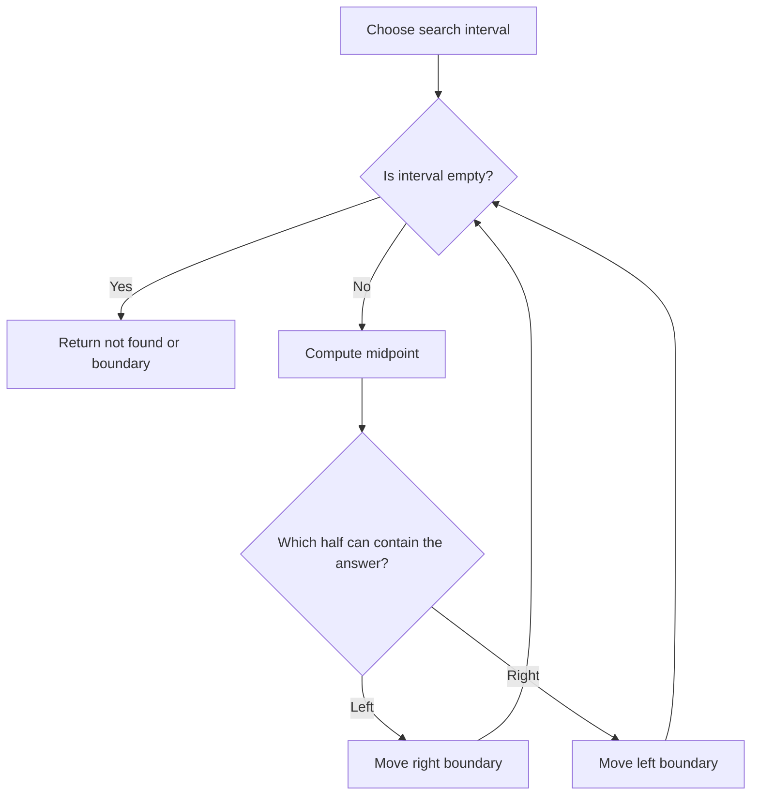

# Binary Search

## 1. How I think about it

Binary search repeatedly discards half of an ordered search space. It works when a condition is **monotonic**: once it becomes true, it stays true.

```text
values:  [1, 3, 4, 7, 9, 12, 15]   target = 9
indexes:  0  1  2  3  4   5   6
                       ^

[0 ................. 7)  mid = 3, value 7  -> search right
            [4 ..... 7)  mid = 5, value 12 -> search left
            [4)           value 9 found
```



- Exact-value search requires sorted input.
- Boundary search requires a monotonic predicate such as `False, False, True, True`.
- I choose one interval convention and preserve it throughout. The templates below use half-open intervals $[left, right)$.
- Each iteration must reduce the interval.

| Variant | Result | Typical use |
| --- | --- | --- |
| Exact search | Index of target or `-1` | Find a value in a sorted array |
| Lower bound | First index with value $\geq$ target | First valid position |
| Upper bound | First index with value $>$ target | Position after duplicates |
| Answer search | Smallest value satisfying a predicate | Minimize a feasible capacity |


## 2. Template

```python
def binary_search(numbers: list[int], target: int) -> int:
    left, right = 0, len(numbers) - 1

    while left <= right:
        middle = left + (right - left) // 2
        if numbers[middle] == target:
            return middle
        if numbers[middle] < target:
            left = middle + 1
        else:
            right = middle - 1

    return -1
```

### 2.1 Edge Cases

- Empty Array: If the input array is empty, left starts at 0, right starts at -1, and the loop will not run, and we will return -1.
- Single Element Array: If the input array has only one element, left, mid, and right will all be the same, and the loop will run once. If the single element is the target, we return its index. Otherwise, left > right, so we exit the loop and return -1.
- Target Not in Array: If the target is not in the array, left will eventually be greater than right, and we will return -1.

## 3. Examples

### 3.1 first value greater than or equal to target

```python
def lower_bound(numbers: list[int], target: int) -> int:
    left, right = 0, len(numbers)

    while left < right:
        middle = left + (right - left) // 2
        if numbers[middle] >= target:
            right = middle
        else:
            left = middle + 1
    return left


numbers = [1, 3, 3, 7, 9]
print(lower_bound(numbers, 3))  # 1
print(lower_bound(numbers, 8))  # 4
```

### 3.2  apple harvest

> Time Complexity: O(n * log m) where m is the maximum number of apples on a tree and n is the number of trees in the apples array. Our binary search runs O(log m) times, and each time it runs it takes n operations to check how long it takes to collect all the apples for that rate.

> Space Complexity: O(1) We are using only a constant amount of space.

```python
class Solution:
    def minHarvestRate(self, apples, h):
        # Binary search on harvest rate: find minimum rate to finish in h hours
        def time_taken(rate):
            time = 0
            # Calculate total time needed at this harvest rate
            for i in range(len(apples)):
                # Ceiling division: (apples[i] + rate - 1) // rate
                time += (apples[i] + rate - 1) // rate  # or math.ceil(apples[i] / rate)
            return time

        # Binary search bounds: minimum rate = 1, maximum rate = max apples
        left, right = 1, max(apples)
        
        # Binary search for minimum valid harvest rate
        while left < right:
            mid = (left + right) // 2
            if time_taken(mid) > h:
                # Rate too slow, need faster rate
                left = mid + 1
            else:
                # Rate is sufficient, try slower rate
                right = mid
                
        return left
```

### 3.3 search in rotated sorted array
> Time Complexity: O(log n) where n is the number of elements in the array. We are reducing the search space by half in each iteration, just like we do in classic binary search.

> Space Complexity: O(1) We are using a constant amount of space.

```python
def search(nums, target):
    left = 0
    right = len(nums) - 1

    while left <= right:
        mid = (left + right) // 2
        if nums[mid] == target:
            return mid

        if nums[left] <= nums[mid]:
            # left half is sorted
            if nums[left] <= target and target < nums[mid]:
                # target is in the left half
                right = mid - 1
            else:
                # target is in the right half
                left = mid + 1
        else:
            # right half is sorted
            if nums[mid] < target and target <= nums[right]:
                # target is in the right half
                left = mid + 1
            else:
                # target is in the left half
                right = mid - 1

    return -1
```

## 4. Complexity

| Measure | Complexity |
| --- | ---: |
| Time | $O(\log n)$ |
| Extra space, iterative | $O(1)$ |
| Extra space, recursive | $O(\log n)$ call stack |

> Time Complexity: O(log n) where n is the number of elements in the input array. We are halving the search space at each step.

> Space Complexity: O(1) We are using a constant amount of space for the pointers, regardless of the size of the input array.

Phrases that usually bring me back to binary search:

- "sorted array"
- "first" or "last" valid position
- "minimum possible maximum"
- "maximum possible minimum"
- a yes/no feasibility test that changes only once

## 5. Mistakes I watch for

- Applying binary search to a predicate that is not monotonic.
- Mixing closed intervals $[left, right]$ with half-open intervals $[left, right)$.
- Returning a boundary without checking whether it is inside the array.
- Moving a boundary to `middle` when that does not shrink the interval.
- Assuming the target exists.