# Heaps and Priority Queues

## 1. Description and declaration

A priority queue removes elements according to priority instead of insertion order. Although we can think of a heap as an array, it's more helpful to visualize a heap as a binary tree

> These two representations of a heap are equivalent. The binary tree representation is a more intuitive way to understand how a heap works. But during the coding interview, you will most likely be working with the array representation of a heap, as it more efficient to work with.

- A min-heap exposes the smallest value: Every parent <= childrens
- A max-heap exposes the largest value: Every parent >= childrens

### Parent-Child Relationship
| Node | Index |
| -------- | ------- |
| Left Child |	2 * i + 1 |
| Right Child |	2 * i + 2 |
| Parent | ⌊(i - 1) / 2⌋ (floor division) |


Python provides the min-heap module `heapq`. TypeScript has no standard priority queue, so I need either a small binary-heap class or a library implementation.

### Python min-heap

```python
import heapq

heap = [5, 1, 4]
heapq.heapify(heap)
heapq.heappush(heap, 2)

print(heap[0])           # 1
print(heapq.heappop(heap))  # 1
```

### Python max-heap
By default, the heapq module creates a min-heap. To create a max-heap, we can negate the values in the list and then convert it into a heap using the heapify function. We also need to remember to negate the values when we push and pop elements from the heap

```python
import heapq

arr = [3, 1, 4, 1, 5, 9, 2]

# negate the values in the array
negated_arr = [-x for x in arr]

# convert array into a min-heap
heapq.heapify(negated_arr) 

# push 11 to the heap by negating it
heapq.heappush(negated_arr, -11)

# peek root of heap = 11
-negated_arr[0]

# pop and return the max element = 11
max_element = -heapq.heappop(negated_arr)

# peek the new max element = 9
-negated_arr[0]
```

### TypeScript min-heap

```typescript
class MinHeap {
    private values: number[] = [];

    get size(): number {
        return this.values.length;
    }

    peek(): number | undefined {
        return this.values[0];
    }

    push(value: number): void {
        this.values.push(value);
        let index = this.values.length - 1;

        while (index > 0) {
            const parent = Math.floor((index - 1) / 2);
            if (this.values[parent] <= this.values[index]) break;
            [this.values[parent], this.values[index]] = [this.values[index], this.values[parent]];
            index = parent;
        }
    }

    pop(): number | undefined {
        if (this.values.length === 0) return undefined;
        if (this.values.length === 1) return this.values.pop();

        const root = this.values[0];
        this.values[0] = this.values.pop()!;
        let index = 0;

        while (true) {
            const left = index * 2 + 1;
            const right = left + 1;
            let smallest = index;

            if (left < this.values.length && this.values[left] < this.values[smallest]) smallest = left;
            if (right < this.values.length && this.values[right] < this.values[smallest]) smallest = right;
            if (smallest === index) break;

            [this.values[index], this.values[smallest]] = [this.values[smallest], this.values[index]];
            index = smallest;
        }

        return root;
    }
}

const heap = new MinHeap();
for (const value of [5, 1, 4, 2]) heap.push(value);

console.log(heap.peek()); // 1
console.log(heap.pop());  // 1
console.log(heap.pop());  // 2
```

### Operations

**1. push(element):  Add a new element to the heap**
> Time complexity: O(log n), where n is the number of items in the heap.

 1. Add the new element to the next available position in the last level of the tree.
 2. "Bubble Up", Compare the new element with its parent. If the new element is less than its parent, swap the two elements. Repeat this process until the new element is greater than its parent, or until it reaches the root of the heap.


Example heap (min-heap, the same one as the figure), stored as the array `[1, 2, 4, 5, 8, 6, 9]`:

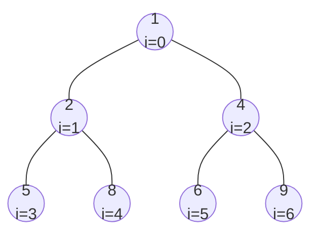

**Example: `push(3)`**

Step 1: Put `3` in the next free position, index 7. Its parent is index 3 (value `5`).

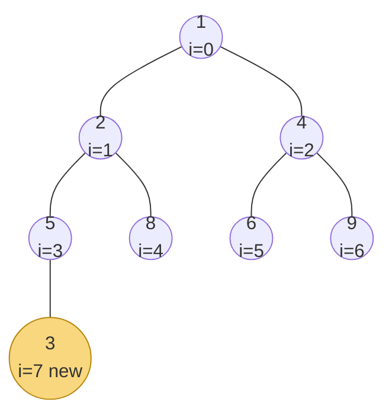

Step 2: `3 < 5`, so bubble up by swapping with the parent. The `3` moves to index 3.

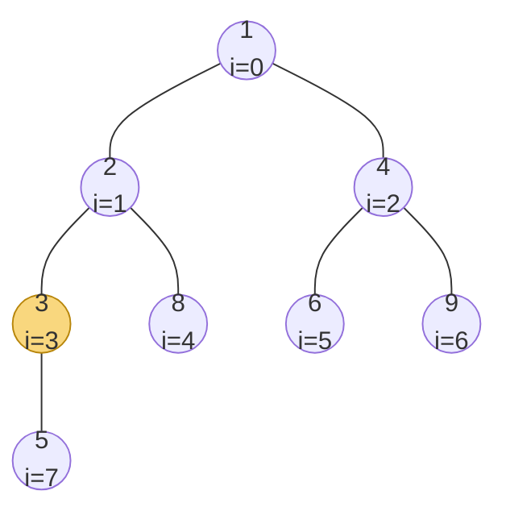

Step 3: The new parent is index 1 (value `2`). `3 > 2`, so bubbling stops. The heap property holds again.

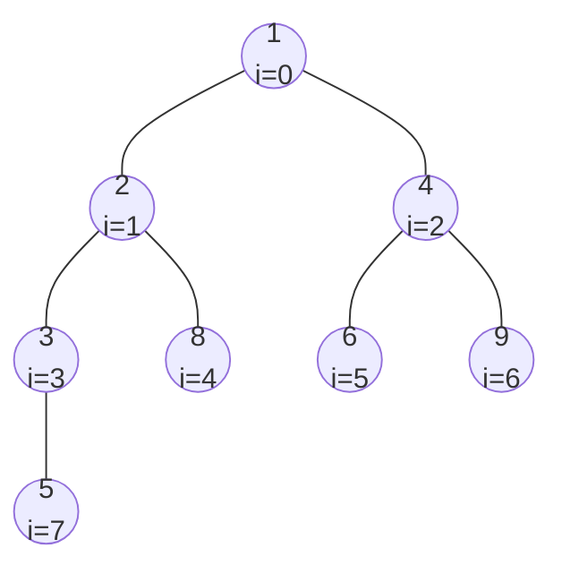

**2.pop(): Remove the root element from the heap**
> Time complexity: O(log n), where n is the number of items in the heap.

1. Remove the root element from the heap, and replace it with the last element in the heap (the rightmost node in the last level).
2. "Bubble Down", Compare the new root with its children. If the new root is greater than either of its children, swap the root with the smaller of the two children. Repeat this process until the new root is less than both of its children, or until it reaches the last level of the heap.
3. Continue Bubbling Down until is complete and the heap property is restored.

**Example: `pop()` on the same heap**

Step 1: Remove the root `1` (returned to the caller). Move the last element, `9`, to the root.

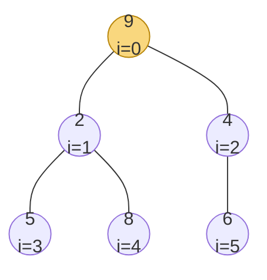

Step 2: `9` is bigger than its children `2` and `4`. Swap it with the smaller child, `2`.

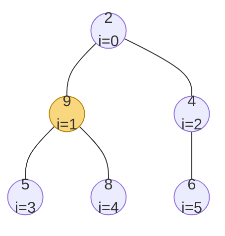

Step 3: `9` is now at index 1, with children `5` and `8`. Swap it with `5`.

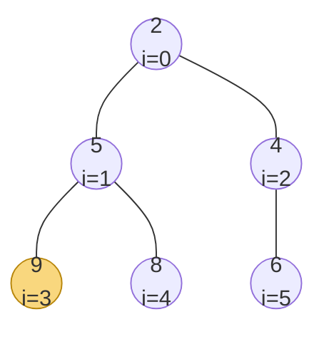

Step 4: `9` has no children, so bubbling stops. The final heap is `[2, 5, 4, 9, 8, 6]`.

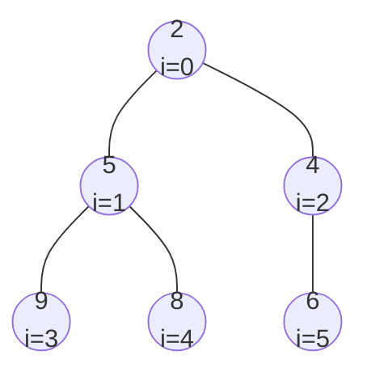

**3. peek(): Get the root element without removing it**
> Time complexity: O(1): The peek operation has a constant time complexity since it only involves accessing the root of the heap, which is always index 0 in the array

The peek operation returns the minimum value in the heap without removing it. The minimum value is always the root of the heap.

**Example: `peek()` on the same heap**

`peek()` returns `1` and does not change the tree.

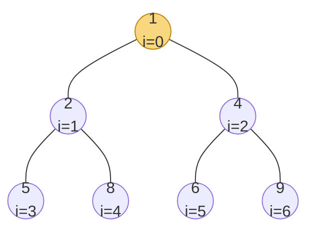

**4. heapify([elements]): Convert an array into a heap in-place**
> Time complexity: O(n), [explanation](https://en.wikipedia.org/wiki/Binary_heap#Building_a_heap)

1. Starting with the first non-leaf node (the parent of the last element in the array), compare the node with its children. If the node is greater than either of its children, swap the node with the smaller of the two children.
2. Move to the next non-leaf node and repeat the process until the root of the tree is reached.

**Example: `heapify([5, 9, 4, 1, 3])`**

The array has `n = 5` elements, so the first non-leaf index is `floor(5 / 2) - 1 = 1`. Heapify starts there and moves toward the root.

Step 1: Start at index 1 (value `9`). Its children are `1` and `3`. Swap with the smaller child, `1`.

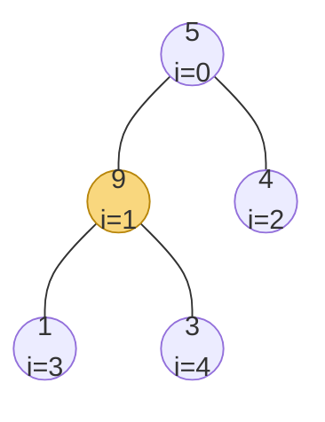

After the swap, the tree looks like this:

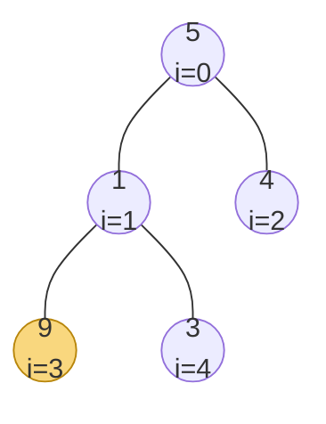

Step 2: Move to index 0 (value `5`). Its children are `1` and `4`. Swap with `1`. The `5` now sits at index 1, with children `9` and `3`. Swap with `3`.

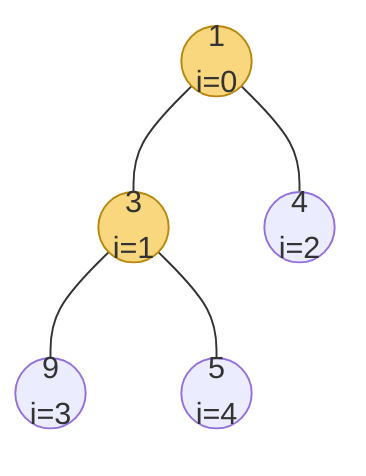

The final heap is `[1, 3, 4, 9, 5]`. Every parent is less than or equal to its children.

## 2. Complexity model

Let $n$ be the number of elements in the heap.

| Operation | Time | Extra space |
| --- | ---: | ---: |
| Peek minimum or maximum | $O(1)$ | $O(1)$ |
| Insert | $O(\log n)$ | $O(1)$ amortized |
| Remove highest-priority element | $O(\log n)$ | $O(1)$ |
| Build with bottom-up heapify | $O(n)$ | Depends on implementation |
| Build with repeated insertion | $O(n \log n)$ | $O(1)$ amortized beyond storage |
| Search for arbitrary value | $O(n)$ | $O(1)$ |
| Sort by repeated removal | $O(n \log n)$ | $O(n)$ for output |

Insertion bubbles a value upward. Removal moves the last value to the root and bubbles it downward. The heap guarantees only the root priority, not complete sorted order.

## 3. Where this fits in my mental model

### When I reach for a heap

I reach for a heap when I repeatedly need the smallest or largest available item while values are still being added or removed.

| Problem type | Heap strategy | Typical complexity |
| --- | --- | ---: |
| Top $k$ largest values | Min-heap of size $k$ | $O(n \log k)$ |
| $k$-th largest value | Min-heap of size $k$ | $O(n \log k)$ |
| Merge $k$ sorted lists | Heap with one item per list | $O(n \log k)$ |
| Task scheduling | Order by next execution time | $O(n \log n)$ |
| Dijkstra's algorithm | Minimum tentative distance | $O((V + E)\log V)$ |
| Running median | One max-heap and one min-heap | $O(\log n)$ per insertion |

## 4. Examples

### 4.1 Top three largest values

```python
import heapq

def three_largest(nums):
    # create a min-heap with the first 3 elements
    heap = nums[:3]
    heapq.heapify(heap)
    
    # iterate through the remaining elements
    for num in nums[3:]:
        if num > heap[0]:
            heapq.heappop(heap)
            heapq.heappush(heap, num)
    
    return heap
```

### 4.2 Kth Largest Element in an Array
Write a function that takes an array of unsorted integers nums and an integer k, and returns the kth largest element in the array. This function should run in O(n log k) time, where n is the length of the array.

```python
import heapq

def kth_largest(nums, k):
    if not nums:
        return 
    
    heap = []
    for num in nums:
        if len(heap) < k:
            heapq.heappush(heap, num)
        elif num > heap[0]:
            heapq.heappushpop(heap, num)
            # or heapq.heapreplace(heap, num)
    
    return heap[0]
```

## 4. Operations cheatsheet

| Operation | Python `heapq` | TypeScript custom heap | Time |
| --- | --- | --- | ---: |
| Bottom-up heapify | `heapq.heapify(values)` | Implement bottom-up heapify | $O(n)$ |
| Build by insertion | Repeated `heappush` | Repeated `push` | $O(n \log n)$ |
| Peek minimum | `heap[0]` | `heap.peek()` | $O(1)$ |
| Insert | `heapq.heappush(heap, value)` | `heap.push(value)` | $O(\log n)$ |
| Remove minimum | `heapq.heappop(heap)` | `heap.pop()` | $O(\log n)$ |
| Push then pop | `heapq.heappushpop(heap, value)` | Push and pop | $O(\log n)$ |
| Replace root | `heapq.heapreplace(heap, value)` | Pop and push | $O(\log n)$ |
| Max-heap number | Store `-value` | Reverse comparator | $O(\log n)$ |
| Priority with payload | `(priority, payload)` tuple | Store object and compare priority | $O(\log n)$ |

## 5. Important considerations

### A heap is not a sorted array

Only the root is guaranteed to have the highest priority. Iterating over the internal array does not produce sorted order.

### How I choose between a min-heap and max-heap

For the top $k$ largest values, keep a min-heap so the smallest accepted value can be removed. For the top $k$ smallest, keep a max-heap.

### Handle equal priorities explicitly

Python compares later tuple fields when priorities tie. Include a unique counter when payloads cannot be compared. In TypeScript, define deterministic tie-breaking in the comparator.

### Stale entries are often simpler than arbitrary deletion

Many heap APIs do not efficiently update or remove arbitrary entries. I can push a new entry and ignore the old one when it reaches the root if it is no longer current; this is the stale-entry technique I use with Dijkstra.

### Generic TypeScript heaps are more reusable

A comparator-based heap supports numbers, tasks, graph states, and custom priorities. During a timed challenge, a numeric heap may be shorter, but a tested generic template reduces implementation errors.
