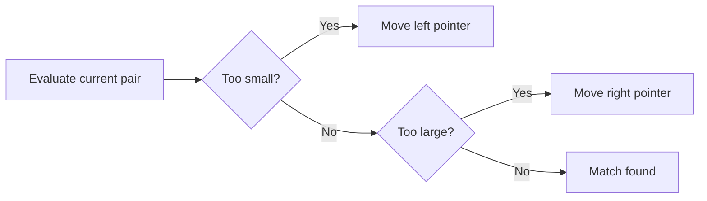

# Two Pointers

## 1. How I think about it

Two pointers coordinate two positions instead of testing every pair. They may move toward each other, in the same direction, or at different speeds.

Consider using the two-pointer technique for questions that involve searching for a pair (or more) of items in an array that meet a certain criteria.

Examples:
- Finding a pair of items that sum to a given target in an array.
- Finding a triplet of items that sum to 0 in a given array.
- Finding the maximum amount of water that can be held between two array items representing wall heights.

```text
Sorted pair sum, target = 8

[1, 2, 4, 6, 10]
 L           R       1 + 10 too large -> R moves left
 L        R          1 + 6 too small  -> L moves right
    L     R          2 + 6 = 8
```



## 2. Template

```python
def twoPointers(nums, target):
  left, right = 0, len(nums) - 1
      
  while left < right:
    current_sum = nums[left] + nums[right]
    if current_sum == target:
        return True
    if current_sum < target:
        left += 1
    else:
        right -= 1
      
  return False
```

## 3. Examples

### 3.1 palindrome validation

```python
def is_palindrome(text: str) -> bool:
    left, right = 0, len(text) - 1
    while left < right:
        if text[left] != text[right]:
            return False
        left += 1
        right -= 1
    return True


print(is_palindrome("racecar"))  # True
```

### 3.2 Triangle Numbers
The sum of every possible pair must exceed the third side.

- Input: nums = [11,4,9,6,15,18]
- Output: 10
- Explanation: Valid combinations are
4, 15, 18
6, 15, 18
9, 15, 18
11, 15, 18
9, 11, 18
6, 11, 15
9, 11, 15
4, 9, 11
6, 9, 11
4, 6, 9

```python
class Solution:
    def triangleNumber(self, nums: List[int]) -> int:
        nums.sort()
        count = 0

        for index in range(len(nums) - 1, 1, -1):  
            # Iterate backwards from the last index 
            # down to index 2 (stop=1 is excluded)
            left, right = 0, index - 1

            while left < right:
                if nums[left] + nums[right] > nums[index]:
                    count += right - left
                    right -= 1
                else:
                    left += 1

        return count
```

## 4. Complexity

| Pattern | Time | Extra space |
| --- | ---: | ---: |
| Opposite pointers | $O(n)$ | $O(1)$ |
| Read/write pointers | $O(n)$ | $O(1)$ |
| Nested scan avoided | Often $O(n)$ instead of $O(n^2)$ | $O(1)$ |

Sorted input, pair conditions, palindrome comparisons, in-place compaction, and linked-list cycles are the signals that bring me back to two pointers.

## 5. Mistakes I watch for

- Applying pair-sum movement rules to unsorted data.
- Allowing both pointers to reference the same element when two are required.
- Moving the wrong pointer after comparing the current state.
- Forgetting that sorting first changes original indexes and costs $O(n \log n)$.
