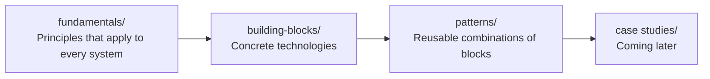
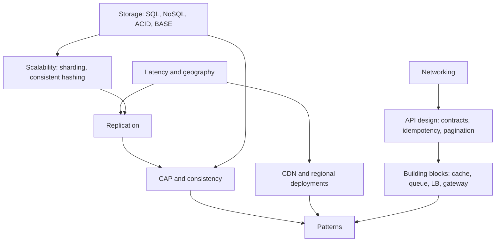

# System Design Notes

Study notes on system design: the principles behind distributed systems, the building blocks that implement them, and the patterns that combine them. The interview delivery framework lives in [system-design-interview.md](./system-design-interview.md).

## Structure

| Folder | What it answers | Read it when |
|---|---|---|
| [fundamentals/](./fundamentals/) | Why do systems behave the way they do? (latency, scaling, replication, CAP) | First, before anything else |
| [building-blocks/](./building-blocks/) | Which tool solves which problem, and at what trade-off? | After the fundamentals |
| [patterns/](./patterns/) | Which combination of blocks solves a class of problem? | When you recognize a problem type |

Files in `fundamentals/` have number prefixes because they are meant to be read in order. The other folders have no numbers because their files are independent and can be read in any order.

## How the concepts connect

Read the tree from the top: each layer uses the ideas from the layer above it. For example, the choice of a cache (building block) is justified by latency (fundamental), and "scaling reads" (pattern) combines replicas and caches.

## Files

### Interview
- [system-design-interview.md](./system-design-interview.md): the delivery framework, the rubric, and a worked Twitter example.

### fundamentals/
- [01-latency-and-geography.md](./fundamentals/01-latency-and-geography.md)
- [02-networking.md](./fundamentals/02-networking.md)
- [03-api-design.md](./fundamentals/03-api-design.md)
- [04-storage.md](./fundamentals/04-storage.md)
- [05-scalability.md](./fundamentals/05-scalability.md)
- [06-replication-and-fault-tolerance.md](./fundamentals/06-replication-and-fault-tolerance.md)
- [07-cap-and-consistency.md](./fundamentals/07-cap-and-consistency.md)
- [08-numbers-to-know.md](./fundamentals/08-numbers-to-know.md)

### building-blocks/
- [databases.md](./building-blocks/databases.md)
- [blob-storage.md](./building-blocks/blob-storage.md)
- [search-databases.md](./building-blocks/search-databases.md)
- [api-gateway.md](./building-blocks/api-gateway.md)
- [load-balancers.md](./building-blocks/load-balancers.md)
- [queues.md](./building-blocks/queues.md)
- [streams.md](./building-blocks/streams.md)
- [distributed-locks.md](./building-blocks/distributed-locks.md)
- [distributed-cache.md](./building-blocks/distributed-cache.md)
- [cdn.md](./building-blocks/cdn.md)

### patterns/
- [realtime-updates.md](./patterns/realtime-updates.md)
- [long-running-tasks.md](./patterns/long-running-tasks.md)
- [contention.md](./patterns/contention.md)
- [scaling-reads.md](./patterns/scaling-reads.md)
- [scaling-writes.md](./patterns/scaling-writes.md)
- [large-blobs.md](./patterns/large-blobs.md)
- [multi-step-processes.md](./patterns/multi-step-processes.md)
- [proximity-services.md](./patterns/proximity-services.md)
- [rate-limiting.md](./patterns/rate-limiting.md)

## Sources

- Hello Interview, [Core Concepts](https://www.hellointerview.com/learn/system-design/in-a-hurry/core-concepts)
- Hello Interview, [Key Technologies](https://www.hellointerview.com/learn/system-design/in-a-hurry/key-technologies)
- Hello Interview, [Common Patterns](https://www.hellointerview.com/learn/system-design/in-a-hurry/patterns)
- Martin Kleppmann, *Designing Data-Intensive Applications* (in [resources/](./resources/)). Cited as "DDIA, Ch. N". Summaries of every chapter were read; the full text is not condensed in these notes.
- Alex Xu, *System Design Interview: An Insider's Guide* (in [resources/](./resources/)). Cited as "Alex Xu, Ch. N". Chapters 2 and 5 were read in full; chapters 1, 4, and 6 were read in their key sections. Chapters 7 to 16 were not read.
- Personal notes: [system-design-interview.md](./system-design-interview.md)