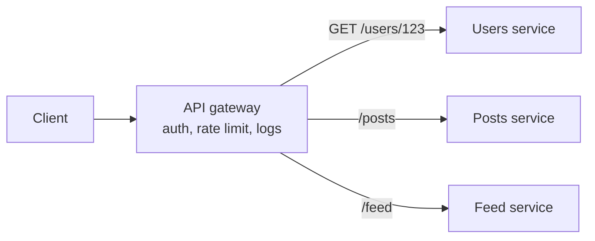

# API gateway

## What it is

An **API gateway** is the single entry point in front of your backend services. It routes each request to the right service and handles cross-cutting concerns: authentication, rate limiting, logging, and sometimes caching or request transformation.

## When to use it

In most product designs, put an API gateway as the first point of contact for clients. Especially with microservices, it keeps clients from knowing every service's address.

The gateway rarely needs deep detail. Spend your design effort on the problem's specific components, and keep the gateway brief.

## Common options

- **AWS API Gateway**, **Kong**, **Apigee**: managed or dedicated gateways.
- **NGINX** or **Apache**: often used as a gateway. Amazon's early fleet of Apache web servers did this job.

## Trade-offs

- One more hop adds latency, usually a few milliseconds.
- The gateway can become a bottleneck or single point of failure. Run several instances behind a [load balancer](./load-balancers.md).
- Business logic does not belong here. Keep it routing and policy only.

## Common mistakes

- Putting business logic in the gateway.
- Forgetting rate limiting or authentication at the edge.
- Drawing a gateway and a load balancer in front of every service. Draw one at the edge.

## Example decision

Clients hit an API gateway that handles JWT validation and per-user rate limits, then routes to the feed and posts services.

## Related

- [Load balancers](./load-balancers.md)
- [API design](../fundamentals/03-api-design.md)
- [Networking](../fundamentals/02-networking.md)

## Sources

- Hello Interview, [Key Technologies: API Gateway](https://www.hellointerview.com/learn/system-design/in-a-hurry/key-technologies)
- Latency added per hop and single point of failure risk: *(general knowledge)*
