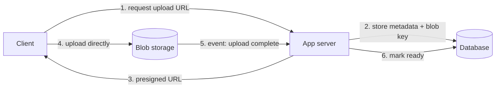

# Blob storage

## What it is

**Blob storage** holds large unstructured files: images, videos, documents, backups. Examples: Amazon S3, Google Cloud Storage, Azure Blob. Storing large files in a relational database is expensive and slow.

## The core rule

Use blob storage for the bytes and a database for the metadata. The database holds a pointer (URL or key) to each blob.

Example: YouTube stores videos in blob storage and titles, owners, and views in a database.

## Upload and download flow

- **Upload:** the client asks the server for a **presigned URL**. The server records the pending upload and returns the URL. The client uploads directly to blob storage. Storage sends a notification when it finishes, and the server updates the status.
- **Download:** the client asks for a file, gets a presigned URL, and downloads through a [CDN](./cdn.md), which fetches from blob storage on a cache miss.

The server never proxies gigabytes of bytes, so it is not a bottleneck.

## Key properties

| Property | What to know |
|---|---|
| Durability | Replication and erasure coding protect data from disk and server failures |
| Scalability | Treat it as effectively unlimited for design purposes |
| Cost | Far cheaper per GB than a database (S3 pricing is roughly 2 cents per GB-month at the start tier; check current prices) |
| Security | Encryption at rest and in transit; access control |
| Chunking | Multipart upload: resumable, parallel uploads for large files |

## Trade-offs

- You now have two stores to keep in sync. A failed upload can leave metadata pointing at nothing. Use states such as `pending` and `ready`.
- Access is by key or URL, not by query. Search and filtering go through the database.

## Common mistakes

- Using S3 as the primary database.
- Proxying uploads through the app server.
- Forgetting the metadata/blob consistency problem.
- Using presigned URLs without an expiry.

## Example decision

Videos go to S3 via presigned URLs, so the upload bypasses our servers. The metadata row is created as `pending` and flips to `ready` when S3 fires the completion event. Playback goes through the CDN.

## Related

- [Large blobs pattern](../patterns/large-blobs.md)
- [CDN](./cdn.md)
- [Databases](./databases.md)

## Sources

- Hello Interview, [Key Technologies: Blob Storage](https://www.hellointerview.com/learn/system-design/in-a-hurry/key-technologies)
- Hello Interview, [Common Patterns: Handling Large Blobs](https://www.hellointerview.com/learn/system-design/in-a-hurry/patterns)
- Pricing figure is from the source page and may be outdated.
