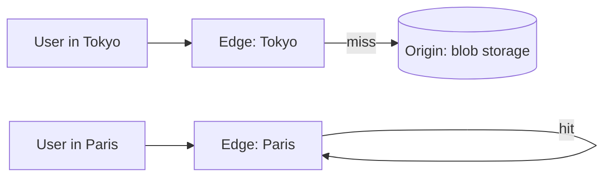

# CDN (content delivery network)

## What it is

A **CDN** is a geographically distributed cache. It stores copies of content on **edge servers** close to users. A request goes to the nearest edge. On a hit, the edge answers immediately. On a miss, the edge fetches from the **origin** (for example, blob storage or your servers), caches it, and returns it.

## When to use one

- **Static media:** profile pictures, images, videos, JavaScript, HTML. Instagram serves profile pictures globally through a CDN.
- **Large files from blob storage:** the usual setup is blob storage as origin and a CDN in front. See [blob storage](./blob-storage.md).
- **Cacheable API responses:** a frequently read, rarely changing API can be cached at the edge to offload servers.
- **Content that changes daily:** a blog post updated once a day can be cached with a TTL.

## Things to know

- Not only for static assets. Dynamic content can be cached when it is read often and changes rarely.
- **Eviction and TTL:** set a time-to-live per object, or invalidate on change.
- **Signed URLs:** control who can access private content.
- Popular providers: **Cloudflare**, **Akamai**, **Amazon CloudFront**. Beyond caching, they offer DDoS protection and web application firewalls.

## Trade-offs

- Stale content until the TTL expires or the cache is purged.
- Cache keys matter: query strings and headers can fragment the cache.
- Global cache means global consistency is weaker. Fine for media, risky for balances or inventory.

## Common mistakes

- Putting a CDN in front of data that must be fresh (account balance, stock count).
- Forgetting the origin: a CDN is a cache, not storage.
- Not setting cache TTLs or an invalidation plan.

## Example decision

Video segments are stored in S3 and served through CloudFront with a one-year TTL, since they are immutable once uploaded. Manifests have a short TTL so new uploads appear quickly.

## Related

- [Blob storage](./blob-storage.md)
- [Latency and geography](../fundamentals/01-latency-and-geography.md)
- [Distributed cache](./distributed-cache.md)

## Sources

- Hello Interview, [Key Technologies: CDN](https://www.hellointerview.com/learn/system-design/in-a-hurry/key-technologies)
- Cache key and immutable-object guidance: *(general knowledge)*
