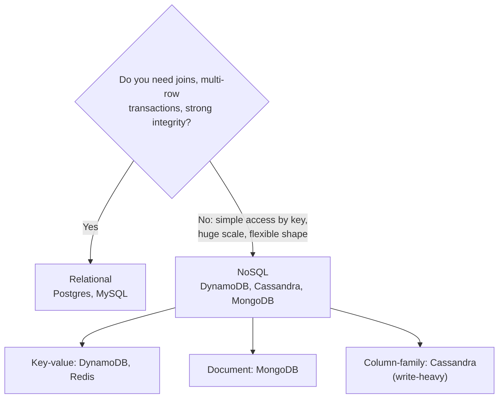

# Databases (relational and NoSQL)

## What it is

The database is where your system's data lives. The two main families are **relational** (tables, SQL, ACID transactions) and **NoSQL** (key-value, document, column-family, graph; flexible schema; usually horizontal scaling). Pick **one** and know it well.

## Relational

- Data in tables of rows and columns, queried with SQL.
- **Joins** combine tables. They are powerful, but a common bottleneck. Minimize them on hot paths.
- **Indexes** (B-tree, hash) speed up lookups. You can add many, including multi-column, geospatial, and full-text indexes.
- **Transactions** group operations so they all succeed or all fail (ACID). Example: create a user and their first post together.
- Common choices: **Postgres** (a common default for product data), MySQL.

## NoSQL

- Schema-flexible. Scales horizontally by [consistent hashing](../fundamentals/05-scalability.md#consistent-hashing) and [sharding](../fundamentals/05-scalability.md#sharding).
- Consistency models range from strong to eventual. See [CAP and consistency](../fundamentals/07-cap-and-consistency.md).
- Common choices: **DynamoDB** (broad features, a favorite), **Cassandra** (write-heavy workloads, append-only storage, fewer query features), **MongoDB** (documents).

## Relational vs NoSQL: how to talk about it

Avoid broad claims like "I need NoSQL for scale" or "relational because I have relationships". Both families overlap heavily: Postgres has JSON columns and scales with replicas and sharding; DynamoDB can model relationships.

Say what you know about the database you chose and why it fits:

> "I'm using Postgres here because its ACID transactions keep order and payment data consistent."

Tip from the source: an explicit SQL vs NoSQL comparison is rarely needed. Focus on the features of your chosen database.

## Trade-offs

| | Relational | NoSQL |
|---|---|---|
| Integrity | Strong (constraints, transactions) | Varies; often per-item |
| Schema | Fixed, migrations | Flexible |
| Scaling | Replicas first; sharding is harder | Horizontal from the start |
| Query flexibility | High (joins, ad-hoc SQL) | Limited to access patterns you designed |

## From the books

**OLTP vs OLAP** (DDIA, Ch. 3): OLTP serves user requests that touch few records by key, so disk seek time matters. OLAP scans millions of rows for analysts, so disk bandwidth matters and column storage helps.

**Storage engines** (DDIA, Ch. 3):
- **B-trees** update pages in place. They are used in most relational databases.
- **LSM-trees** (SSTables, LevelDB, Cassandra, HBase) only append and merge. They turn random writes into sequential writes, which makes writes fast.

**Transactions and isolation** (DDIA, Ch. 7):
- *Read committed* prevents dirty reads and dirty writes.
- *Snapshot isolation* (repeatable read, often MVCC) prevents read skew.
- *Serializable* isolation is the only level that prevents write skew, where two transactions read the same data, decide based on it, and both write.
- Lost updates (two read-modify-write cycles overwrite each other) need either automatic detection or explicit locks such as `SELECT ... FOR UPDATE`.

**Data models** (DDIA, Ch. 2): document databases suit self-contained records with few cross-document relationships. Graph databases suit highly connected data. Relational databases handle many-to-many relationships. Document and graph stores often do not enforce a schema, which moves the schema check to read time.

## Common mistakes

- Saying "relational doesn't scale" without knowing that a single Postgres handles a few TB and many read replicas.
- Choosing NoSQL without naming the access pattern it serves.
- Heavy joins across shards.
- Forgetting indexes on the query you described.

## Example decision

Users and orders go in Postgres for transactional integrity. Feed items are written at a high rate with simple key lookups, so they go in DynamoDB partitioned by `user_id`.

## Related

- [Storage fundamentals](../fundamentals/04-storage.md)
- [Blob storage](./blob-storage.md) (large files)
- [Search databases](./search-databases.md)
- [Replication and fault tolerance](../fundamentals/06-replication-and-fault-tolerance.md)

## Sources

- Hello Interview, [Key Technologies: Core Database](https://www.hellointerview.com/learn/system-design/in-a-hurry/key-technologies)
- Personal notes: "storage (relational, document based, key value, ACID vs BSE)" ([system-design-interview.md](../system-design-interview.md))
