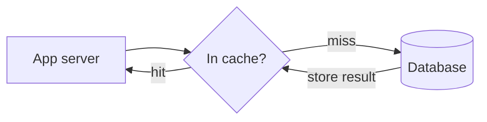

# Distributed cache

## What it is

A **cache** is a server, or cluster, that keeps data in memory so reads are fast and the database is spared. A **distributed cache** spreads that memory across nodes. The two common choices are **Redis** and **Memcached**.

## When to use one

1. **Save aggregated metrics:** an analytics dashboard computed hourly by a background job and stored for instant reads.
2. **Reduce database queries:** user sessions kept in the cache so every request does not hit the database.
3. **Speed up expensive queries:** a Twitter-style "posts from people I follow" query is run once and stored as a sorted set.

## Things to know

- **Eviction policy:** what leaves when memory is full. LRU (least recently used), LFU (least frequently used), FIFO.
- **Invalidation:** how the cache stays current. Example: a Ticketmaster event cache must be invalidated when its venue changes in the database.
- **Write strategy:**
  - *Write-through:* write to cache and database together. Consistent, slower writes.
  - *Write-around:* write only to the database. Avoids filling the cache with rarely read data, but the next read misses.
  - *Write-back:* write to cache, flush to the database later. Fast writes, but data is lost if the cache fails before the flush.
- **Data structures:** Redis supports strings, hashes, lists, sets, sorted sets, bitmaps, and HyperLogLogs. Name the structure you use. "Store events in a sorted set by popularity" is a stronger answer than "store events in a cache."

## Redis vs Memcached

| | Redis | Memcached |
|---|---|---|
| Data types | Rich (sorted sets, hashes, lists, ...) | Strings and binary objects |
| Persistence and replication | Available | Not built in |
| Use when | You need structures, ranking, locks, or rate limits | You need a plain, simple cache |

## Scaling

Partition keys across cache nodes with [consistent hashing](../fundamentals/05-scalability.md#consistent-hashing), so adding a node moves only a small share of keys.

## Trade-offs

- Stale data until invalidation.
- A cache failure can send all traffic to the database at once (cache stampede). Mitigate with replicas and staggered expiry (general knowledge).
- Memory is expensive compared with disk.

## Common mistakes

- "I'll store the events in a cache" with no structure, key, or eviction policy named.
- Forgetting invalidation.
- Caching data that changes every request, so the hit rate is near zero.
- Ignoring hit rate. A cache with under 80% hit rate needs a second look (see [numbers to know](../fundamentals/08-numbers-to-know.md)).

## Example decision

Timelines are precomputed and stored in a Redis sorted set per user, keyed by timestamp, so the feed is a single range query. When a followed user posts, add the post to the followers' sorted sets. Eviction is LRU, and the TTL is 7 days.

## Related

- [Scaling reads pattern](../patterns/scaling-reads.md)
- [CDN](./cdn.md) (a cache for static and cacheable responses at the edge)
- [Numbers to know](../fundamentals/08-numbers-to-know.md)

## Sources

- Hello Interview, [Key Technologies: Distributed Cache](https://www.hellointerview.com/learn/system-design/in-a-hurry/key-technologies)
- Cache stampede mitigation: *(general knowledge)*
