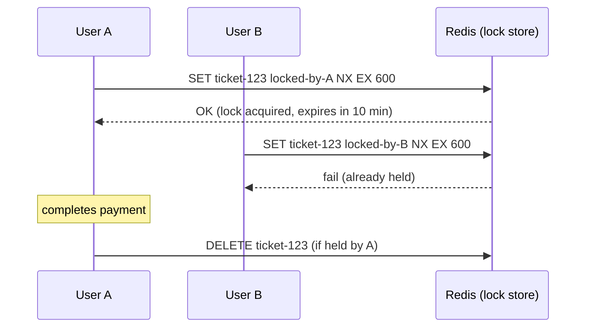

# Distributed locks

## What it is

A **distributed lock** gives one process exclusive access to a resource across machines, for a bounded time. A database transaction lock is for milliseconds to seconds inside one database. A distributed lock covers longer periods and spans systems, such as "hold ticket 123 for 10 minutes while the user pays."

## How it works

A key-value store with atomic set-if-absent is enough. Only the process that sets the key first holds the lock. Releasing the lock deletes or unlocks the key. An **expiry** guarantees the lock frees itself if the holder crashes.

Implementations: **Redis** (a common choice; Redlock uses several Redis instances for safety) and **ZooKeeper**.

## When to use one

- **E-commerce checkout:** hold limited-edition sneakers in a cart for about 10 minutes during payment.
- **Ride matching:** lock a nearby driver so they cannot take two riders at once until they accept or decline.
- **Distributed cron:** only one server runs the daily aggregation job.
- **Auction bidding:** briefly lock an item in the final seconds while a bid is processed.

## Things to know

- **Expiry:** a crashed holder must not block the resource forever. Choose an expiry longer than the normal operation, and check the holder before releasing, so you do not release someone else's lock.
- **Granularity:** lock one ticket, or a whole section of seats.
- **Deadlocks:** two processes each hold one lock and wait for the other. Prevent it by always acquiring locks in the same order. Keep locks in one place in the code; locks spread across far-flung infrastructure are hard to reason about.

## Trade-offs

- Locks add latency and failure modes. If the lock service is down, the resource may be unavailable.
- An expired lock can be taken by a second process while the first one is still working. Use a fencing token (a monotonically increasing number checked by the resource) if correctness requires it (general knowledge).
- For a single database, prefer a transaction or a conditional update (`UPDATE ... WHERE status = 'available'`). Distributed locks are for cross-system or long-held coordination.

## Common mistakes

- Using a distributed lock where a database constraint would work.
- Forgetting expiry, so a crash locks a resource forever.
- Releasing a lock without checking ownership.
- Not saying what happens when the lock expires mid-operation.

## Example decision

When a user starts checkout, set a Redis key for the seat with a 10-minute expiry, using SET NX so only one user can hold it. Payment confirms the booking in the database in a transaction and releases the lock. If the user abandons checkout, the expiry frees the seat.

## Related

- [Dealing with contention pattern](../patterns/contention.md)
- [Consistency per feature](../fundamentals/07-cap-and-consistency.md)
- [Distributed cache](./distributed-cache.md) (Redis)

## Sources

- Hello Interview, [Key Technologies: Distributed Lock](https://www.hellointerview.com/learn/system-design/in-a-hurry/key-technologies)
- SET NX example, ownership checks, and fencing tokens: *(general knowledge)*
