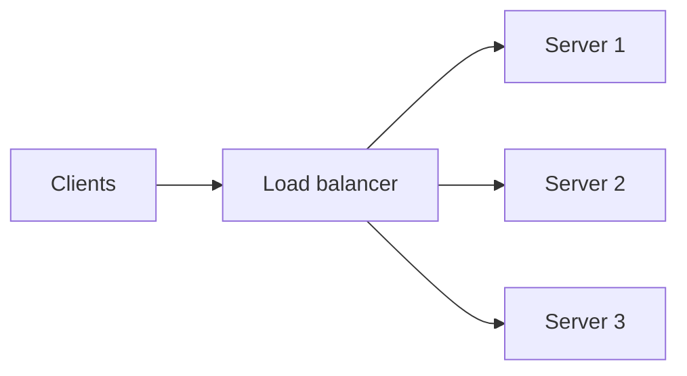

# Load balancers

## What it is

A **load balancer** spreads incoming traffic across several machines that can serve the same request. It is what makes [horizontal scaling](../fundamentals/05-scalability.md) work. For design purposes, treat it as a black box that distributes work.

## When to draw one

You need one wherever several machines serve the same request. Avoid drawing one in front of every service. Either:

- Draw one at the front of the design as an abstraction, or
- Leave it out and say "these services are horizontally scaled behind a load balancer."

## L4 vs L7

| | L4 (transport) | L7 (application) |
|---|---|---|
| Sees | IP and TCP/UDP | HTTP headers, paths, cookies |
| Routing | Fast, per connection | Flexible: route `/api/users` to one service and `/api/feed` to another |
| Persistent connections (WebSockets) | Good fit | Connection load falls on the LB |
| Use when | Long-lived connections, raw speed | Path routing, auth, sticky sessions by cookie |

Rule of thumb from the source: **persistent connections such as WebSockets usually call for L4**. Otherwise, L7 gives routing flexibility while reducing downstream connection load.

## Common options

- **AWS Elastic Load Balancer** (managed)
- **NGINX** (open-source web server often used as a load balancer)
- **HAProxy** (open-source load balancer)
- Hardware load balancers outperform software ones at extreme traffic, but they belong to network engineering.

## Algorithms (general knowledge)

- Round robin: simple and even when requests cost the same.
- Least connections: better when requests vary in duration.
- Hash-based (for example, by user ID): sticky routing, which helps caches.

## Common mistakes

- Putting a load balancer in front of every service in the diagram.
- Forgetting that WebSockets need persistent connections and sticky routing.
- Treating the load balancer itself as infinitely reliable. Run more than one.

## Example decision

Put an L7 load balancer in front of the stateless API servers so requests can be routed by path. The real-time chat servers hold WebSocket connections, so they sit behind an L4 balancer with connection stickiness.

## Related

- [API gateway](./api-gateway.md)
- [Scalability](../fundamentals/05-scalability.md)
- [Realtime updates pattern](../patterns/realtime-updates.md)

## Sources

- Hello Interview, [Key Technologies: Load Balancer](https://www.hellointerview.com/learn/system-design/in-a-hurry/key-technologies)
- Round robin and least connections: *(general knowledge)*
