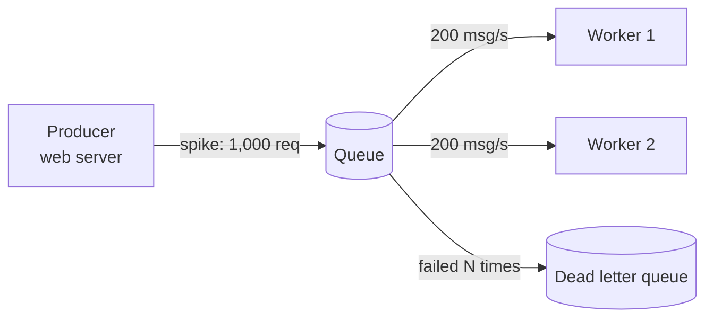

# Queues

## What it is

A **queue** holds messages between a producer and a consumer. The producer sends a message and moves on. A pool of workers pulls messages and processes them at their own pace. Use queues to **buffer bursts** and **distribute work**.

If a spike sends 1,000 requests and workers handle 200 per second, the other 800 wait in the queue. They are not dropped. Producers and consumers also scale independently.

## Use cases

1. **Buffer for bursty traffic:** ride requests spiking during a concert ends in Uber.
2. **Distribute work:** photo filters or video encoding are sent to a worker pool.

## Things to know

- **Ordering:** most queues are FIFO. Kafka can order by partition key or priority.
- **Retries:** configure attempts and delay between them.
- **Dead letter queue (DLQ):** where messages go after too many failures. Inspect them to find poison messages.
- **Partitioning:** spread the queue across brokers for scale. Choose a partition key so related messages land in the same partition.
- **Backpressure:** a queue hides overload rather than fixing it. If the system handles 200 req/s and receives 300 req/s, the queue grows forever. Slow or reject producers when the queue is full.

## Technologies

- **Kafka:** distributed streaming platform used as a queue. See [streams](./streams.md).
- **SQS:** fully managed queue on AWS.
- Redis lists or streams are also used for small job queues (general knowledge).

## Trade-offs

- Adds latency. Do not put a queue in a synchronous path with a strict budget, such as under 500 ms; you will almost certainly break it.
- More moving parts: DLQs, retries, idempotent consumers.
- Asynchronous responses: the client needs a job ID or a notification. See [long-running tasks](../patterns/long-running-tasks.md).

## From the books

**Two kinds of message broker** (DDIA, Ch. 11):
- **AMQP/JMS-style brokers** assign each message to one consumer, delete it after acknowledgment, and do not keep history. Good for task queues where order does not matter.
- **Log-based brokers** (see [streams](./streams.md)) assign a partition to one consumer, keep ordered messages on disk, and let consumers replay from an offset.

## Common mistakes

- Adding a queue to a synchronous request path with a tight latency SLA.
- Ignoring backpressure.
- Forgetting retries and what happens with a poison message.
- Using a queue without explaining who consumes it and how fast.

## Example decision

Image processing jobs go onto an SQS queue. The API returns a job ID immediately. A worker pool pulls jobs, and after five failed attempts a message goes to a dead letter queue for inspection. If the queue depth grows past a threshold, autoscale workers and return 429 to the uploader.

## Related

- [Streams](./streams.md)
- [Long-running tasks pattern](../patterns/long-running-tasks.md)
- [Scaling writes](../patterns/scaling-writes.md)

## Sources

- Hello Interview, [Key Technologies: Queue](https://www.hellointerview.com/learn/system-design/in-a-hurry/key-technologies)
- Redis as a queue and the 429 response: *(general knowledge)*
