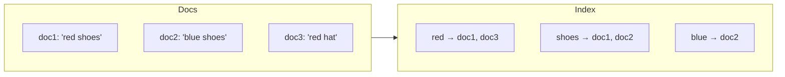

# Search-optimized databases

## What it is

A **search-optimized database** supports full-text search: finding documents that contain words, ranked by relevance, with typo tolerance. A plain SQL `LIKE '%term%'` scans every row, so it does not scale.

## How it works: the inverted index

An inverted index maps each word to the documents that contain it.

A query for "red shoes" looks up `red` and `shoes`, then intersects the lists. No table scan.

Building blocks of the index:

- **Tokenization:** split text into words.
- **Stemming:** reduce words to a root ("running" and "runs" both match "run").
- **Fuzzy search:** tolerate misspellings using edit distance (how many letters to change, add, or remove).

## Options

- **Elasticsearch:** the clear leader. Distributed, built on Apache Lucene, used for search and analytics. Netflix, Uber, and Yelp use it.
- **Database full-text search:** Postgres GIN indexes support full-text search. Redis has a search module, but the source describes it as immature.

Using your existing database reduces the number of moving parts. Know that the option exists, and move to a dedicated engine when search is a core feature.

## Scaling

Same as other databases: add nodes to a cluster and shard the index.

## Trade-offs

- The search index is a copy of your data. It can lag behind the source of truth; updates usually flow through a [queue](./queues.md) or [stream](./streams.md).
- Relevance tuning and operations are real work.

## Common mistakes

- Using `LIKE '%term%'` in a design that has a search feature.
- Saying "Elasticsearch" without explaining the inverted index. The source warns that you should be able to explain it.
- Treating the search index as the source of truth.

## Example decision

Event search needs typo tolerance and ranking, so index events in Elasticsearch. Updates to the events table flow through a Kafka topic into the index, which can be a few seconds behind.

## Related

- [Databases](./databases.md)
- [Streams](./streams.md)
- [Storage fundamentals](../fundamentals/04-storage.md)

## Sources

- Hello Interview, [Key Technologies: Search Optimized Database](https://www.hellointerview.com/learn/system-design/in-a-hurry/key-technologies)
- Index update flow via Kafka is *(general knowledge)*.
