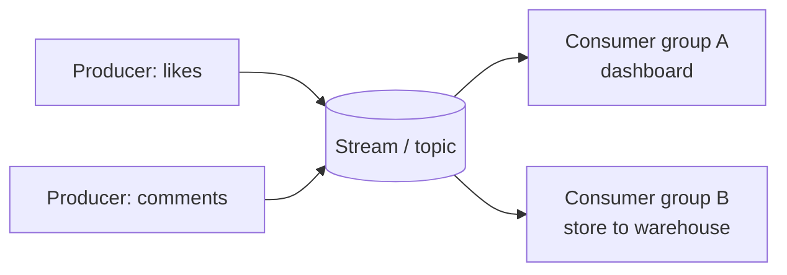
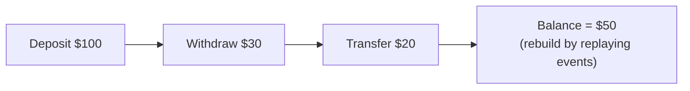

# Streams and event sourcing

## What it is

A **stream** is an append-only log of events. Unlike a [queue](./queues.md), a message is **retained** for a configurable time, and consumers can re-read from any position or time. Use streams for high-volume real-time data, event sourcing, and fan-out to many consumers.

## When to use one

1. **Real-time processing of large volumes:** engagement events (likes, comments, shares) feed a live analytics dashboard through Flink or Spark Streaming.
2. **Event sourcing:** state changes are stored as events and can be replayed. A bank records every deposit, withdrawal, and transfer, so it can audit, roll back, or rebuild any account's balance.
3. **Many consumers on the same data:** a chat message is published to a room's stream, and every participant's connection consumes it.

## Event sourcing in one picture

## Things to know

- **Partitioning:** split the stream across servers for scale. Pick a partition key so related events stay in order (for example, `account_id`).
- **Consumer groups:** each group reads the full stream independently. One group updates a dashboard while another writes history.
- **Replication:** copies across brokers so a failed server does not lose data.
- **Windowing:** group events by time or count, for example the mean delivery time per region over the last 24 hours.

## Technologies

- **Kafka:** the usual choice. See the Hello Interview Kafka deep dive.
- **Flink:** stream processing engine.
- **Kinesis:** AWS streaming service.

## Trade-offs

- Replaying events is powerful but needs a plan for schema changes and old events.
- Ordering only holds within a partition.
- More operational weight than a simple queue. Use a queue when you only need job distribution.

## From the books

**Log as the core abstraction** (DDIA, Ch. 11): the log is the streaming equivalent of a filesystem. Consumers track their offset, so they can rebuild state or reprocess history.

**Databases as streams** (DDIA, Ch. 11): change data capture (CDC) reads the database's change log, and event sourcing records changes as events. Log compaction keeps the latest value per key, so the log holds a full copy of the data.

**Derived data** (DDIA, Ch. 12): search indexes, caches, and analytics are derived from a system of record and kept up to date by consuming the log. A rebuilt view can be produced by replaying the log from the start.

**Integrity without distributed transactions** (DDIA, Ch. 12): give each operation an end-to-end ID so retries are idempotent, and check constraints asynchronously. The user either waits for the check or accepts that an apology may be needed later.

## Common mistakes

- Using a stream where a simple queue would do.
- Forgetting the partition key, which determines ordering.
- Saying "event sourcing" without saying how state is rebuilt or how snapshots limit replay time (general knowledge).

## Example decision

Every like and comment is published to a Kafka topic keyed by post ID, so each post's events stay ordered. The analytics consumer group aggregates them into a live dashboard, and a separate group writes them to the warehouse. Because Kafka retains events, a new consumer can backfill from the last week.

## Related

- [Queues](./queues.md)
- [Search databases](./search-databases.md) (index updates from a stream)
- [Realtime updates pattern](../patterns/realtime-updates.md)

## Sources

- Hello Interview, [Key Technologies: Streams / Event Sourcing](https://www.hellointerview.com/learn/system-design/in-a-hurry/key-technologies)
- Snapshots, schema evolution, and Kinesis details: *(general knowledge)*
