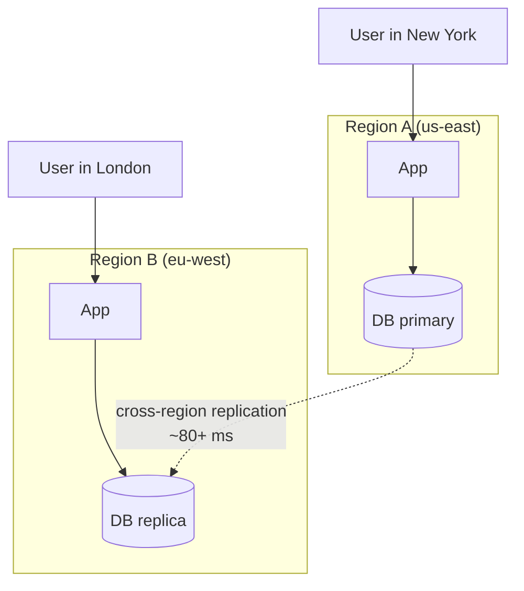

# Latency and Geography

## What it is

Latency is the time a request takes to travel and be processed. Geography sets a floor on latency: light in fiber needs time to cover distance, so no software optimization can beat physics.

## Latency scale

| Operation | Typical latency |
|---|---|
| Cache hit (Redis) | ~1 ms |
| Database query (uncached) | ~20-50 ms |
| Network call inside a data center | ~1-10 ms |
| New York to London (speed of light in fiber) | at least ~80 ms |

See [08-numbers-to-know.md](./08-numbers-to-know.md) for more reference numbers.

## Same region vs cross region

- **Same region:** calls take milliseconds. Coordinating writes is cheap.
- **Cross region:** every synchronous call pays the distance. Multi-region designs usually keep data close to the user and accept replication lag.

## When to reach for geography

- Users are spread across the world and need low latency: deploy regionally and replicate or partition data by geography.
- Static content: serve it from edge servers with a [CDN](../building-blocks/cdn.md).
- Synchronous cross-region writes add latency that a consistency requirement may force you to accept. See [07-cap-and-consistency.md](./07-cap-and-consistency.md).

## Example decision

Between regions, a round trip costs tens to hundreds of milliseconds. Keep the synchronous path in one region, serve users from the closest one, and replicate asynchronously across regions.

## Common mistakes

- Ignoring the speed of light and assuming a global system can be as fast as a local one.
- Putting a cache where a cache does not help (for example, data that changes on every request).
- Assuming a CDN fixes dynamic, per-user data. A CDN mainly helps static or cacheable content.

## Related

- [02-networking.md](./02-networking.md)
- [06-replication-and-fault-tolerance.md](./06-replication-and-fault-tolerance.md)
- [CDN](../building-blocks/cdn.md)
- [Distributed cache](../building-blocks/distributed-cache.md)

## Sources

- Hello Interview, [Core Concepts: Networking Essentials](https://www.hellointerview.com/learn/system-design/in-a-hurry/core-concepts), section "Geography and latency"
- Hello Interview, [Core Concepts: Numbers to Know](https://www.hellointerview.com/learn/system-design/in-a-hurry/core-concepts)
