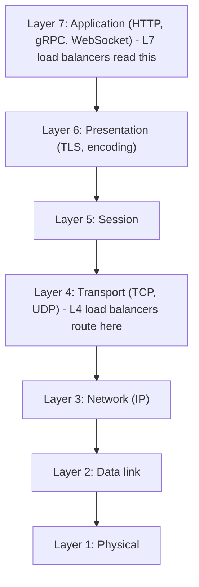
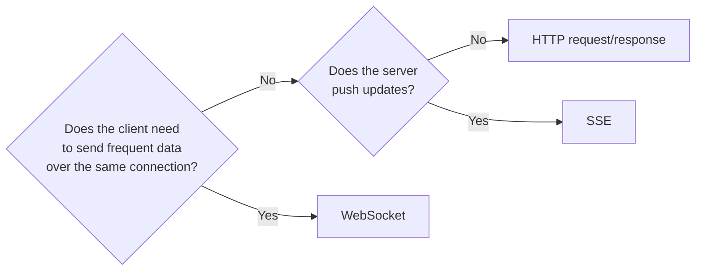

# Networking

## What it is

Networking is how services talk to each other and to clients. You need to define: which protocol to use, how real-time updates travel, and how traffic is balanced across machines.

## Layers

*(general knowledge: the OSI model)*



For system design, you mostly reason about layers 4 and 7.

## Default choice: HTTP over TCP

HTTP over TCP handles about 90% of use cases. It is well understood, works everywhere, and is the expected default unless you have a reason to choose otherwise.

## Choosing a communication protocol

| Protocol | Direction | Use when | Trade-off |
|---|---|---|---|
| **HTTP request/response** | Client to server | Default for CRUD and most APIs | Client must ask for updates |
| **HTTP polling** | Client asks repeatedly | Simple updates, low frequency | Wasteful at scale |
| **Long polling** | Server holds the request open until data exists | Near real-time without new infrastructure | Still holds connections |
| **Server-Sent Events (SSE)** | Server to client only | Live scores, notifications, feeds | Client cannot send over the same connection; works with standard HTTP infrastructure |
| **WebSocket** | Both ways | Chat, live collaboration, frequent client messages | Stateful connections, harder to scale and balance |
| **gRPC** | Both ways (HTTP/2) | Internal service-to-service calls where performance matters | Browsers do not support it natively (gRPC-Web needs a proxy); binary, not human-readable |



Common mistake: proposing WebSockets just because the problem says "real-time." Start with polling, then move to SSE or WebSockets when needed.

Common pattern: REST for external APIs, gRPC for internal traffic.

## Application protocols in detail

Every protocol below runs on top of HTTP (or, for WebRTC, UDP). The differences are how the API is modeled, how data is serialized, and who can start a message.

### REST

REST models the system as **resources** (like tables or files) and uses HTTP methods to act on them. It is the default for public APIs.

```
GET    /users/{id}            -> 200 OK, User
POST   /users                 -> 201 Created, User (server assigns the id)
PUT    /users/{id}            -> 200 OK, User (full replacement)
PATCH  /games/{id}            -> 200 OK, { "status": "started" } (partial update)
DELETE /users/{id}            -> 204 No Content
GET    /users/{id}/posts      -> 200 OK, [Post] (nested relationship)
```

Example request and response:

```
POST /users HTTP/1.1
Content-Type: application/json

{ "username": "stefan.mai", "email": "stefan@example.com" }

HTTP/1.1 201 Created
Location: /users/42
{ "id": 42, "username": "stefan.mai", "email": "stefan@example.com" }
```

- Model nouns, not actions. `PUT /users/{id}` is RESTful. `updateUser` is an operation, so it is not.
- Use status codes to communicate outcome: 200, 201, 204, 400, 401, 403, 404, 429, 500, 502.
- **Trade-off:** simple and cacheable, but clients can over-fetch or under-fetch, and JSON is verbose for high-throughput internal traffic.

### GraphQL

GraphQL exposes a single endpoint, usually `POST /graphql`. The client sends a query that describes exactly which fields it needs, and the server returns data in that shape.

Problem it solves:

- **Under-fetching:** one page needs a list of users plus details for each user, so REST needs 1 + N requests.
- **Over-fetching:** `GET /users/{id}` returns 40 fields when the screen needs 3.

Example query and response:

```graphql
query GetUsersWithGroups($limit: Int = 10) {
  users(limit: $limit) {
    id
    username
    profile { fullName avatar }
    groups { id name }
  }
}
```

```json
{
  "data": {
    "users": [
      {
        "id": "1",
        "username": "stefan.mai",
        "profile": { "fullName": "Stefan Mai", "avatar": "/img/1.png" },
        "groups": [{ "id": "g1", "name": "Backend" }]
      }
    ]
  }
}
```

- **Trade-off:** the backend must resolve nested fields efficiently. Without care (for example, batching with DataLoader), one query can trigger many database calls. Caching by URL also stops working because every request is a `POST`.
- Good fit: mobile and web clients that change often, or several teams querying overlapping data. For a fixed set of access patterns, REST is usually simpler.

### RPC and gRPC

RPC (Remote Procedure Call) models the API as **functions** the client calls on a remote server, such as `GetUser(id)`, instead of resources. gRPC is Google's RPC framework. It uses HTTP/2 and Protocol Buffers (protobuf), a binary format with a strict schema.

```proto
syntax = "proto3";

message User {
  string id = 1;
  string name = 2;
}

message GetUserRequest {
  string id = 1;
}

service UserService {
  rpc GetUser (GetUserRequest) returns (User);
}
```

- The `= 1`, `= 2` are field numbers. They identify fields in the binary encoding, so they must never change once published.
- Size comparison from the source: the JSON `{"id":"123","name":"John Doe"}` is about 40 bytes, while the protobuf encoding of the same data is about 15 bytes.
- The `.proto` file generates client and server code in many languages. Built-in features include streaming, deadlines, and client-side load balancing.
- **Trade-off:** fast and strongly typed, but browsers cannot call gRPC directly (they need gRPC-Web and a proxy), and the binary payload is not readable with `curl`.
- Good fit: internal service-to-service calls. Public APIs usually stay REST.

### Server-Sent Events (SSE)

SSE lets the server push many messages over **one long HTTP response**. It is one-way (server to client). The browser's `EventSource` API handles parsing and reconnection.

Server response (`Content-Type: text/event-stream`):

```
id: 101
event: score-update
data: {"match": "ARG-FRA", "score": "2-1"}

id: 102
event: score-update
data: {"match": "ARG-FRA", "score": "2-2"}
```

Client:

```js
const source = new EventSource("/matches/42/events");
source.addEventListener("score-update", (e) => {
  console.log(JSON.parse(e.data));
});
```

- **Reconnection:** when the connection drops, `EventSource` reconnects and sends `Last-Event-ID: 102`. The server must replay messages after that ID, so it needs to keep a short history.
- **Limitations:** proxies and load balancers may close long-lived responses, and some networks buffer the stream and deliver it in batches.
- **Trade-off:** simple, works over standard HTTP, and passes through most infrastructure. But the client cannot send data over the same channel.
- Good fit: notifications, live scores, auction price updates, activity feeds.

### WebSockets

WebSockets give a **persistent, two-way** channel over one TCP connection. The connection starts as an HTTP request and is then upgraded.

Handshake:

```
GET /chat HTTP/1.1
Host: example.com
Upgrade: websocket
Connection: Upgrade
Sec-WebSocket-Key: dGhlIHNhbXBsZSBub25jZQ==
Sec-WebSocket-Version: 13

HTTP/1.1 101 Switching Protocols
Upgrade: websocket
Connection: Upgrade
```

After the `101` response, both sides send messages at any time, without a new request. The protocol on top is up to you. JSON messages are common:

```json
{ "type": "message", "room": "general", "text": "hi" }
{ "type": "message", "room": "general", "text": "hello back" }
```

- The handshake reuses cookies and headers from HTTP, so authentication can happen at upgrade time.
- Every intermediary (proxies, firewalls, load balancers) must support upgraded connections.
- **Trade-off:** the lowest latency for two-way traffic, but each connection is stateful. You need L4 load balancing, connection tracking, and a reconnect strategy.
- Good fit: chat, multiplayer games, collaborative editing, and other high-frequency two-way traffic. If the server only pushes, SSE is usually enough.

### WebRTC (brief)

WebRTC sends audio, video, or data **directly between browsers** (peer-to-peer), usually over UDP. Peers first find each other through a signaling server, then use STUN (discover public address) or TURN (relay when a direct path fails).

- Good fit: video and audio calls and conferencing.
- Trade-off: complex, and a server is still needed for signaling and fallback relays. For most apps, a server-based design is simpler.

### How to pick

| Need | Choose |
|---|---|
| Public CRUD API | REST |
| Many clients with different data needs | GraphQL |
| Internal service calls, performance-sensitive | gRPC |
| Server pushes updates, client rarely sends | SSE |
| Frequent two-way messages | WebSocket |
| Peer-to-peer audio or video | WebRTC |

## Stateful connections

WebSockets and SSE keep a connection open to one server. You cannot balance them like stateless HTTP requests. Plan for:

- Connection persistence (which server holds which user).
- What happens when a server with thousands of connections goes down. Clients must reconnect and recover missed updates.

## Load balancing at the network level

- **Layer 4 (TCP):** fast, routes connections without reading content. Use for persistent connections such as WebSockets.
- **Layer 7 (HTTP):** reads the request and can route `/api/*` and `/web/*` to different services. Costs more CPU but offers more routing.

Details: [load-balancers.md](../building-blocks/load-balancers.md).

## Geography and CDNs

Network distance is latency. Serve static content from edge servers close to users with a [CDN](../building-blocks/cdn.md). See [01-latency-and-geography.md](./01-latency-and-geography.md).

## Example decision

Use HTTP over TCP for the API. For a live feed, start with polling and move to SSE if the update rate justifies it. Choose WebSockets only when clients must push frequently, because they add stateful connections that need L4 balancing.

## Related

- [03-api-design.md](./03-api-design.md)
- [Realtime updates pattern](../patterns/realtime-updates.md)
- [Load balancers](../building-blocks/load-balancers.md)
- [API gateway](../building-blocks/api-gateway.md)

## Sources

- Hello Interview, [Core Concepts: Networking Essentials](https://www.hellointerview.com/learn/system-design/core-concepts/networking-essentials)
- Hello Interview, [In a Hurry: Core Concepts](https://www.hellointerview.com/learn/system-design/in-a-hurry/core-concepts)
- Hello Interview, [Common Patterns: Pushing Realtime Updates](https://www.hellointerview.com/learn/system-design/in-a-hurry/patterns)
- Personal notes: "networking (layers)"
