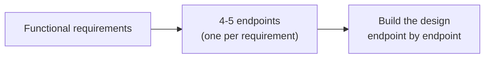

# API Design

## What it is

The API is the contract between your system and its clients. A good starting point is one endpoint per key requirement (usually 4 to 5). Keep the detail proportional to the problem: the endpoints matter most, and deep API detail rarely does.

## Default: REST

REST maps resources to URLs and uses HTTP methods to act on them.

| Method | Path | Meaning |
|---|---|---|
| GET | `/users/{id}` | Read a user |
| POST | `/users` | Create a user |
| POST | `/events/{id}/bookings` | Create a booking for an event |
| PUT / PATCH | `/users/{id}` | Update a user |
| DELETE | `/users/{id}` | Delete a user |

REST is the common default unless a different style has a clear advantage.

## Other protocols

| Style | Use when |
|---|---|
| **GraphQL** | Many clients with different data needs; clients should request exactly the fields they need |
| **RPC / gRPC** | Internal calls where performance is critical; action-oriented |

## Concepts to mention when relevant

| Concept | Guidance |
|---|---|
| **Pagination** | Offset-based is fine for most cases. Cursor-based works better when new items are added frequently (feeds). |
| **Authentication** | JWT tokens for user sessions; API keys for service-to-service calls |
| **Rate limiting** | Mention when the system can be hammered by bots or abuse. Usually enforced at the [API gateway](../building-blocks/api-gateway.md). |

Go deeper only when a requirement depends on the detail, such as pagination rules or auth behavior.

## Process



Example from the Twitter design in [delivery-framework.md](../process/delivery-framework.md):

```
POST /v1/tweets
GET  /v1/tweets/{tweetId}
POST /v1/follows
GET  /v1/feed
```

## Common mistakes

- Spending more than a couple of minutes on endpoint details.
- Designing endpoints that do not map to any requirement.
- Forgetting pagination on list endpoints such as `/feed`.

## Example decision

Use REST. `POST /v1/tweets` creates a tweet, and `GET /v1/feed` returns a paginated list using a cursor, since new tweets arrive constantly.

## Related

- [02-networking.md](./02-networking.md)
- [Delivery framework](../process/delivery-framework.md)
- [API gateway](../building-blocks/api-gateway.md)

## Sources

- Hello Interview, [Core Concepts: API Design](https://www.hellointerview.com/learn/system-design/in-a-hurry/core-concepts)
- Personal notes: [system-design-interview.md](../system-design-interview.md), endpoint example for the Twitter design
