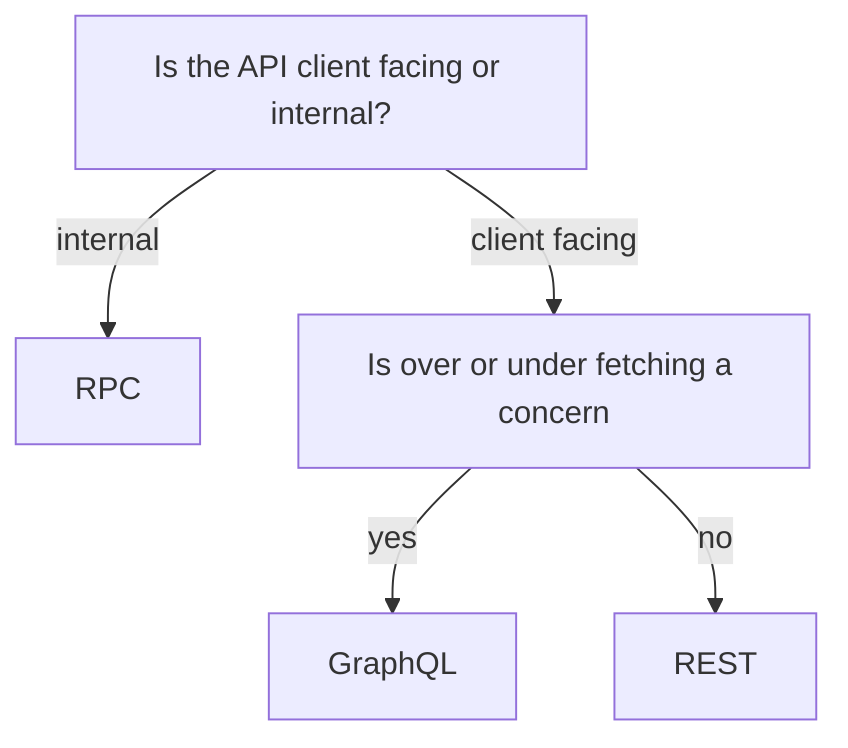
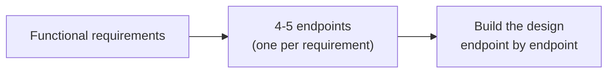

# API Design

## What it is

The API is the contract between your system and its clients. A good starting point is one endpoint per key requirement (usually 4 to 5). Keep the detail proportional to the problem: the endpoints matter most, and deep API detail rarely does.

## API Types

### 1. ( Default )  REST (Representational State Transfer) 

REST maps resources to URLs and uses HTTP methods to act on them.

| Method | Path | Meaning |
|---|---|---|
| GET | `/users/{id}` | Read a user |
| POST | `/users` | Create a user |
| POST | `/events/{id}/bookings` | Create a booking for an event |
| PUT / PATCH | `/users/{id}` | Update a user |
| DELETE | `/users/{id}` | Delete a user |

REST is the common default unless a different style has a clear advantage.

**Resource modeling**
- Resources are things, not actions: `POST /payments`, not `/processPayment`; `GET /users/{id}/bookings`, not `/getUserBookings`.
- Use plural nouns (`/events`, `/bookings`).
- Nest when the parent is required (`/events/{id}/tickets`). Use query params for optional filters (`/tickets?event_id=123&section=VIP`).

**HTTP methods and idempotency**

| Method | Idempotent | Notes |
|---|---|---|
| GET | Yes | Never changes data |
| PUT | Yes | Replaces the whole resource (or creates it) |
| PATCH | Not guaranteed | "set email to X" is idempotent; "append to list" is not |
| DELETE | Yes | Repeated calls leave the same state, even if the status changes (204, then 404) |
| POST | No | Each call creates a new resource; needs an idempotency key for retries |

**Passing data**
- Path params identify the resource (required): `/events/123`.
- Query params filter, sort, or paginate (optional): `/events?city=NYC&page=2&limit=20`.
- Request body carries the payload for create/update, including large or sensitive data.

**Status codes to know:** 200 OK, 201 Created, 400 Bad Request, 401 Unauthorized (not authenticated), 403 Forbidden (authenticated but not allowed), 404 Not Found, 429 Too Many Requests, 500 Server Error.

>[!NOTE]
> Each type of input serves a different role in the API's contract. Path parameters are structural, they determine which endpoint you're hitting. Query parameters are modifiers, they change how the endpoint behaves. Request body is payload, it's the data you're actually working with.

```
method: POST
url: /events/{event_id}/bookings
query params: notify
body: {
    "tickets": [...],
    "payment_method": ""
}

POST /events/123/bookings?notify=true
{
  "tickets": [
    {"section": "VIP", "quantity": 2},
    {"section": "General", "quantity": 1}
  ],
  "payment_method": "credit_card"
}
```

### 2. GraphQL
Many clients with different data needs; clients should request exactly the fields they need, flexible data fetching. Instead of REST's resource endpoints, you design a schema that defines your data types and their relationships.

- One endpoint; the client chooses the fields it needs. Solves over-fetching and under-fetching across mobile and web clients.
- Adds complexity: query parsing, schema validation, caching.
- Watch out for the **N+1 problem** (100 events with venues = 101 queries). Fix with batching/DataLoader.
- Authorization is per field, not per endpoint.

```
POST /grapql -> url
query {      -> body
  event(id: "123") {
    name
    date
    venue {
      name
      address
    }
    tickets {
      section
      price
      available
    }
  }
}
```

### 3. RPC (Remote Procedure Call)
Internal calls where performance is critical; action-oriented. You're essentially calling functions across a network as if they were local functions in your codebase

- Uses Protocol Buffers (gRPC) and HTTP/2, which is faster than JSON over HTTP/1.1 for service-to-service calls.
- Generates typed client/server code from a `.proto` contract, so mismatches are caught at compile time.
- Supports streaming. Example: `getEvent(eventId)` instead of `GET /events/123`.

```
// Instead of GET /events/123
getEvent(eventId: "123")

// Instead of POST /events/123/bookings
createBooking(eventId: "123", userId: "456", tickets: [...])

// Instead of GET /events/123/tickets
getAvailableTickets(eventId: "123", section: "VIP")
```

**Protocol Buffers and Type Safety**
gRPC uses Protocol Buffers (protobuf) to define service contracts. You write a .proto file that describes your service methods and data structures. From this single definition, gRPC generates client and server code in multiple programming languages. This means your Go backend service and your Java payment service can communicate with compile-time type safety, catching mismatches before deployment.

```
service TicketService {
  rpc GetEvent(GetEventRequest) returns (Event);
  rpc CreateBooking(CreateBookingRequest) returns (Booking);
  rpc GetAvailableTickets(GetTicketsRequest) returns (TicketList);
}

message GetEventRequest {
  string event_id = 1;
}

message Event {
  string id = 1;
  string name = 2;
  int64 date = 3;
  Venue venue = 4;
}
```

<br>



## Concepts to mention when relevant

| Concept | Guidance |
|---|---|
| **Pagination** | Offset-based is fine for most cases. Cursor-based works better when new items are added frequently (feeds). |
| **Authentication** | JWT tokens for user sessions; API keys for service-to-service calls |
| **Rate limiting** | Mention when the system can be hammered by bots or abuse. Usually enforced at the [API gateway](../building-blocks/api-gateway.md). Return 429 when exceeded. Example: 10 booking attempts/minute per user to stop ticket scalping. |
| **Idempotency keys** | For POST endpoints that create money or bookings (payments, orders). The client sends an `Idempotency-Key` header; the server stores the first result and returns it for retries. Prevents double booking or double charge. |
| **Consistent errors** | One error envelope everywhere: `{"error": {"code": "SEAT_UNAVAILABLE", "message": "..."}}`. The stable `code` is for clients to branch on; `message` is for humans. |
| **Versioning** | URL versioning (`/v1/events`) is the safe interview default. Header versioning is cleaner but less visible. Adding fields is safe; renaming or removing them is breaking. |
| **Filtering and sorting** | Query params: `?status=paid`, `?sort=-date` (leading `-` means descending). Keep names consistent across endpoints (`status`, not `state` in one and `status` in another). |
| **Auth: API keys vs JWT** | API keys for service-to-service and third-party developers. JWT for user sessions in web and mobile apps (stateless; the signature is verified without a DB lookup). |
| **Authorization** | Authentication verifies identity - proving the user is who they claim to be. Authorization verifies permissions - checking if that authenticated user is allowed to perform the specific action they're requesting. |


## Design principles

1. **Resources, not actions.** Ask which resource you manipulate before writing an endpoint.
2. **Be consistent.** Same naming, parameters, and response shapes everywhere.
3. **Least surprise.** GET never changes data; 200 means success (no `"success": false` inside a 200).
4. **Stateless.** Each request carries its auth token, params, and payload. Any server can handle it, so scaling is a load balancer problem.
5. **Safe retries.** Use idempotency keys on POSTs that users care about.
6. **Paginate anything that can grow**, with a cap on page size (`?limit=100000` must not be allowed).
7. **Secure by default.** Require auth unless an endpoint is explicitly public; check authorization per resource.
8. **Evolve without breaking clients.** Old mobile app versions live for years.
9. **Actionable errors.** Right status class plus a machine-readable code and a readable message.


## Process



Example from the Twitter design in [system-design-interview.md](../system-design-interview.md):

```
POST /v1/tweets
GET  /v1/tweets/{tweetId}
POST /v1/follows
GET  /v1/feed
```

`POST /v1/tweets` creates a tweet, and `GET /v1/feed` returns a paginated list using a cursor, since new tweets arrive constantly.

## Related

- [02-networking.md](./02-networking.md)
- [Delivery framework](../system-design-interview.md)
- [API gateway](../building-blocks/api-gateway.md)

## Sources

- Hello Interview, [Core Concepts](https://www.hellointerview.com/learn/system-design/in-a-hurry/core-concepts)
- Hello Interview, [API Design](https://www.hellointerview.com/learn/system-design/core-concepts/api-design)
