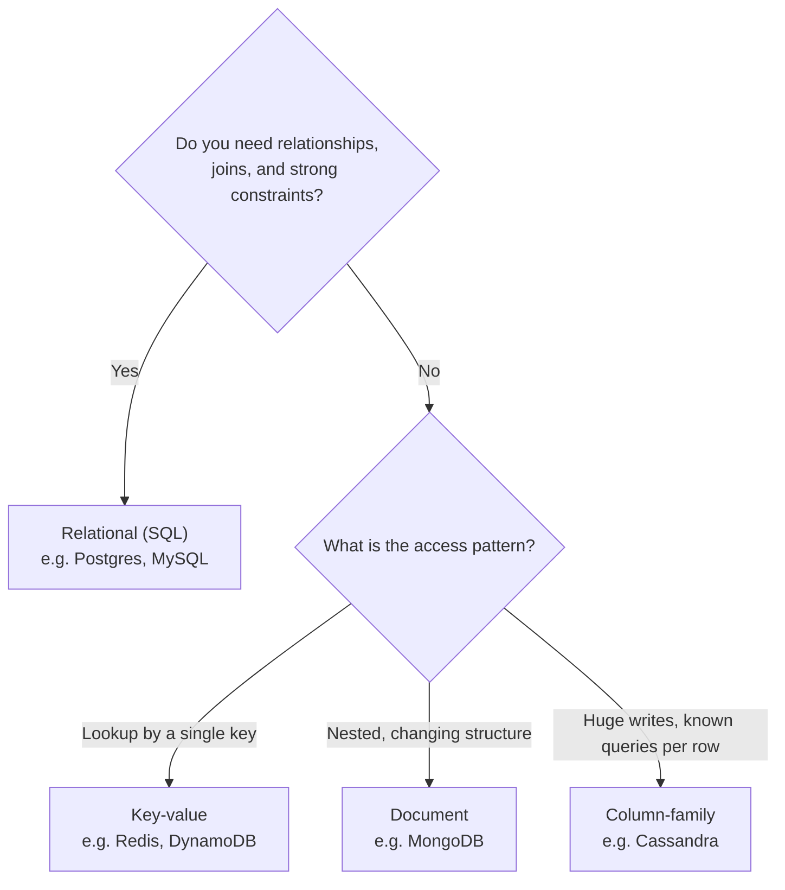
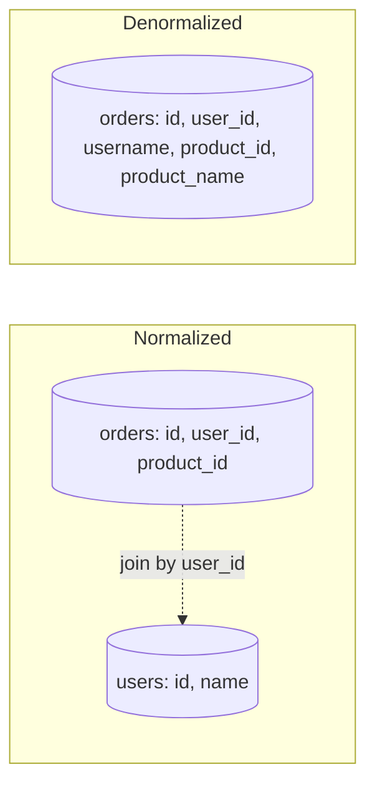
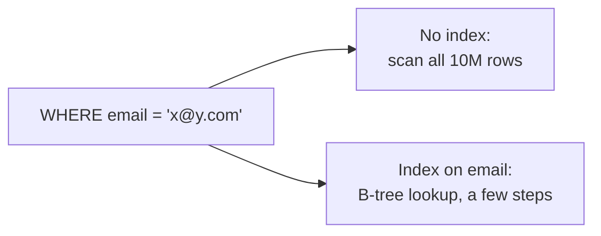

# Storage

This file covers the *concepts* behind storage choices. Specific products are in [databases.md](../building-blocks/databases.md), [blob-storage.md](../building-blocks/blob-storage.md), and [search-databases.md](../building-blocks/search-databases.md).

## Choosing a database family

| Family | Data model | Strength | Trade-off |
|---|---|---|---|
| **Relational** | Tables, rows, columns, foreign keys | Joins, transactions, constraints, flexible queries | Harder to scale writes horizontally; joins get expensive on large tables |
| **Key-value** | Key to value | Very fast, simple, scales horizontally | Only access by key (unless you add indexes) |
| **Document** | JSON-like documents | Flexible schema, nested data | Joins across documents are weak |
| **Column-family** | Wide rows, partitioned by key | Write-heavy workloads at scale | Limited query flexibility; design around queries |
| **Graph** | Nodes and edges | Relationship traversal | Specialized; rarely the default |

Avoid broad claims like "I need NoSQL because of scale" or "I need SQL because of relationships." Both relational and NoSQL databases can handle either. Name the database you pick and the specific feature that solves the problem. For example: "Postgres, because ACID transactions protect data integrity."

Common starting point: for product-style data with relationships, pick a relational database. For high-volume infrastructure data, consider a NoSQL database.

## ACID vs BASE

These describe how strict the guarantees are.

| | ACID | BASE |
|---|---|---|
| **Typical systems** | Relational databases | Many NoSQL and distributed systems |
| **Meaning** | **A**tomicity: all or nothing. **C**onsistency: rules hold after each transaction. **I**solation: concurrent transactions do not interfere. **D**urability: committed data survives crashes. | **B**asically **A**vailable: the system responds even with failures. **S**oft state: data can change over time without input. **E**ventually consistent: replicas converge given time. |
| **Choose when** | Money, inventory, bookings: correctness matters more than availability | Feeds, likes, analytics: availability and speed matter more than instant accuracy |

*(general knowledge: ACID and BASE definitions)*

Transactions are the main ACID feature in practice. Example: create a user and their first post together. Either both exist or neither does.

## Data modeling

### Normalization vs denormalization

| | Normalized | Denormalized |
|---|---|---|
| **Storage** | Each fact stored once | Facts copied into multiple places |
| **Reads** | Needs joins | Fast, single-table reads |
| **Writes / updates** | Update once | Update every copy (for example, a username change) |
| **Best for** | Start here; consistency matters | Read-heavy, rarely changing data; hot paths |

Default: start normalized. Denormalize specific hot paths when you can point to a read problem. Do not propose denormalization upfront without a reason.

### NoSQL data modeling

Design around access patterns. In DynamoDB-style stores, the partition key decides where data lives:

- Query "all posts for user X": partition key `user_id`. That query is a fast single-partition lookup.
- Query "all posts that mention hashtag Y": not supported well. It needs a scan or another table keyed by hashtag.

List the queries first, then design the keys.

## Indexes

An index is an extra structure that speeds up lookups at the cost of storage and slower writes.

| Index type | Good for |
|---|---|
| **B-tree** (default) | Exact lookups and range queries (dates, prices) |
| **Hash** | Exact lookups only; no ranges |
| **Composite** (multi-column) | Queries on several fields, such as city plus date |
| **Full-text** | Word search. See [search-databases.md](../building-blocks/search-databases.md) |
| **Geospatial** | "Find places within 5 miles." See [proximity-services.md](../patterns/proximity-services.md) |

Tip: list the fields your queries filter on and propose indexes on those. For "find user by email", index `email`.

External search indexes are usually fed from the primary database through **change data capture (CDC)**. They lag slightly behind, which is acceptable for search.

## Blob storage

Do not store large files (images, videos) in a relational database. Store the file in object storage and keep a URL in the database. Details: [blob-storage.md](../building-blocks/blob-storage.md).

## Common mistakes

- Choosing a database by brand instead of by access pattern.
- Sharding before trying indexes, replicas, and caches.
- Using a database as a queue or as blob storage.
- Forgetting that joins become a bottleneck on large tables.

## Example decision

Users and orders need transactions, so use Postgres. Index `user_id` on orders for the "my orders" query. Product search goes to Elasticsearch, fed by CDC, so search results can be a few seconds stale.

## Related

- [Databases](../building-blocks/databases.md)
- [Scalability](./05-scalability.md)
- [CAP and consistency](./07-cap-and-consistency.md)
- [Search databases](../building-blocks/search-databases.md)

## Sources

- Hello Interview, [Core Concepts: Data Modeling](https://www.hellointerview.com/learn/system-design/in-a-hurry/core-concepts) and [Database Indexing](https://www.hellointerview.com/learn/system-design/in-a-hurry/core-concepts)
- Hello Interview, [Key Technologies: Core Database](https://www.hellointerview.com/learn/system-design/in-a-hurry/key-technologies)
- Personal notes: "storage (relational, document based, key value, ACID vs BASE)"
