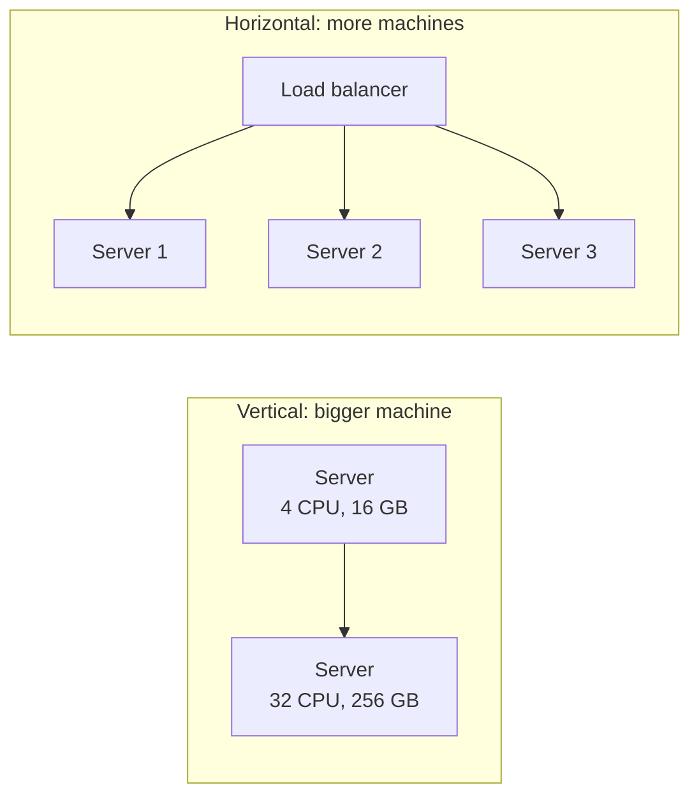
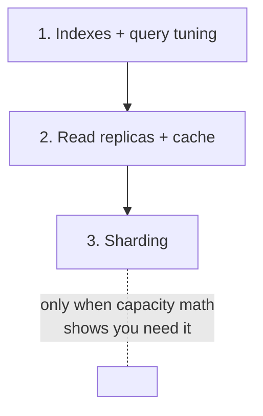
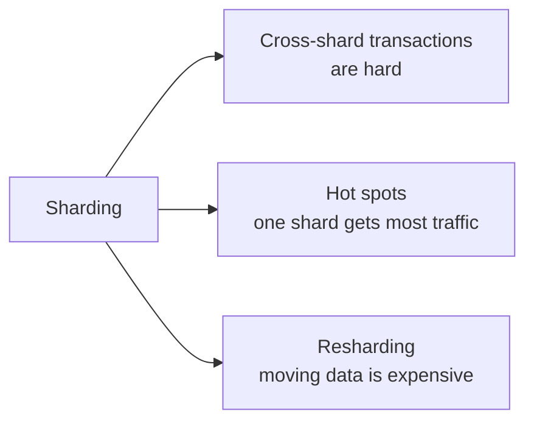
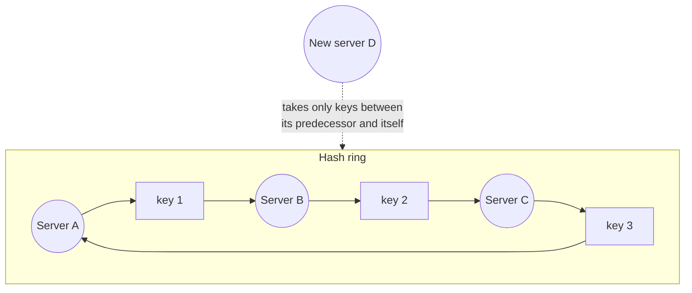

# Scalability

## What it is

Scalability is the ability to handle more load by adding resources. You scale **compute** (servers that process requests) and **storage** (where data lives) differently.

## Vertical vs horizontal

| | Vertical | Horizontal |
|---|---|---|
| **How** | Bigger CPU, RAM, disk | More machines behind a [load balancer](../building-blocks/load-balancers.md) |
| **Limit** | Hardware ceiling; single point of failure | Coordination, data consistency |
| **Use for compute** | Good first step; simple | Default for stateless services |
| **Use for storage** | Limited (a single Postgres handles a few TB) | Requires [sharding](#sharding) |

Guideline: scale stateless compute horizontally behind a load balancer. Scale storage horizontally only when the numbers justify it.

## Scaling compute

Stateless services can be copied freely. Keep state (sessions, connections) out of the app servers, or in a shared store such as [Redis](../building-blocks/distributed-cache.md), so any server can handle any request.

## Scaling storage

Storage has three levers, in the order to try them:

1. **Indexes and query tuning** (see [04-storage.md](./04-storage.md))
2. **Read replicas and caches** (see [06-replication-and-fault-tolerance.md](./06-replication-and-fault-tolerance.md))
3. **Sharding:** split data across independent databases

## Sharding

Sharding splits data across multiple independent servers. Reasons: storage limit, write throughput, or read load replicas cannot absorb.

### The shard key decides everything

For a user-centric app like Instagram, shard by `user_id`:

- A user's posts, likes, and comments live on one shard, so user-scoped queries are fast.
- Global queries ("trending posts across all users") must hit every shard and merge results.

### Sharding strategies

| Strategy | How | Pros | Cons |
|---|---|---|---|
| **Hash** | `hash(key) % N` | Even distribution; avoids hot spots | Adding shards moves most keys (see [consistent hashing](#consistent-hashing)) |
| **Range** | Key ranges per shard (A-F, G-M, ...) | Good for range queries; natural for multi-tenant SaaS | Hot spots if one range gets most traffic |
| **Directory** | Lookup table maps key to shard | Flexible | Extra lookup on every request; rarely worth it |

### Problems sharding creates

- **Cross-shard transactions:** a bank transfer between accounts on different shards needs distributed transactions or sagas. Both are complex and slow. Design shard boundaries to avoid them.
- **Hot spots:** one celebrity's shard gets hammered while others sit idle.
- **Resharding:** adding a shard means moving a lot of data.

Guideline: do not shard early. A well-tuned single database with replicas handles much more than most people expect. Do the capacity math first. For example, 10K writes per second and 100 GB of data usually do not need sharding. Then name the shard key and its trade-off: fast for X queries, slow for Y queries.

## Consistent hashing

### The problem

With `hash(key) % N`, changing N (adding or removing a server) remaps almost every key. With millions of cache entries, that is a disaster.

### The idea

Place both servers and keys on a ring. A key belongs to the first server found going clockwise.

- **Add a server:** only the keys between the new server and its predecessor move.
- **Remove a server:** only its keys move to the next server clockwise.
- Result: about 10% of keys move when adding one server to a 10-server cluster, instead of about 90% with modulo hashing.

Where it is used: Memcached and Redis Cluster (cache nodes), Cassandra and DynamoDB (sharding), some load balancers, and CDNs.

Guideline: you rarely need to explain the algorithm. Describe the outcome: "we'll use consistent hashing to distribute keys across cache nodes so adding a node does not move most of the data." Bring it up when discussing elastic scaling.

## Scaling reads and writes

| Workload | Typical first steps |
|---|---|
| **Reads** (10:1 to 100:1 ratio common) | Indexes, denormalization, read replicas, [distributed cache](../building-blocks/distributed-cache.md), [CDN](../building-blocks/cdn.md). See [scaling-reads](../patterns/scaling-reads.md). |
| **Writes** | Batching, [queues](../building-blocks/queues.md) to absorb bursts, sharding, vertical partitioning. See [scaling-writes](../patterns/scaling-writes.md). |

## From the books

**Consistent hashing details** (Alex Xu, Ch. 5):
- Modulo hashing (`hash(key) % N`) remaps almost every key when N changes. Consistent hashing remaps only about k/n keys on average (k keys, n slots).
- **Virtual nodes:** each physical server owns many points on the ring. This evens out partition sizes. More virtual nodes mean a smaller standard deviation of load, at the cost of more metadata. A server with more capacity gets more virtual nodes.
- Adding a server takes keys from its clockwise neighbor only. Removing a server hands its keys to the next server clockwise.
- It also reduces hot spots, because popular keys are spread across servers.

**Partitioning schemes** (DDIA, Ch. 6):
- **Key-range partitioning** keeps keys sorted, so range queries are efficient, but sequential keys (for example, timestamps) can create hot spots.
- **Hash partitioning** spreads load evenly, but range queries across partitions become scatter-gather.
- **Secondary indexes:** *document-partitioned* (local) indexes make writes touch one partition but reads scatter to all. *term-partitioned* (global) indexes make reads hit one partition but writes touch several.
- Fixed number of partitions per node, rebalanced by moving whole partitions, is a common way to add or remove nodes.

## Common mistakes

- Sharding at 500 GB or when the database is far from its limits.
- Choosing a shard key that makes the main query a scatter-gather across all shards.
- Scaling compute vertically when stateless horizontal scaling is simpler.
- Assuming resharding is free.

## Example decision

The app servers are stateless, so scale them horizontally behind a load balancer. The database handles our write volume with headroom, so add read replicas and a Redis cache first. Shard by `user_id` only if the capacity math shows we pass the single-node limit, and use consistent hashing so resharding moves minimal data.

## Related

- [Storage](./04-storage.md)
- [Replication and fault tolerance](./06-replication-and-fault-tolerance.md)
- [Scaling reads](../patterns/scaling-reads.md)
- [Scaling writes](../patterns/scaling-writes.md)
- [Distributed cache](../building-blocks/distributed-cache.md)

## Sources

- Hello Interview, [Core Concepts: Sharding](https://www.hellointerview.com/learn/system-design/in-a-hurry/core-concepts)
- Hello Interview, [Core Concepts: Consistent Hashing](https://www.hellointerview.com/learn/system-design/in-a-hurry/core-concepts)
- Personal notes: "scalability (vertical and horizontal for compute, sharding and consist hashing for storage)"
