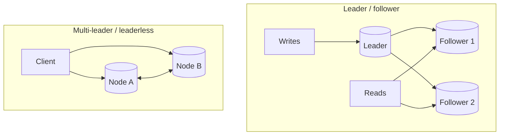

# Replication and fault tolerance

## What it is

Machines fail. Disks die, networks drop packets, data centers lose power. **Fault tolerance** is the system's ability to keep working when parts fail. **Redundancy** is the extra copies of data and servers that make that possible. **Replication** is the act of keeping those copies in sync.

## Failure modes

Name the failure before you design the fix.

| Failure | Example | Typical response |
|---|---|---|
| Server crash | App server or DB node dies | Stateless retry on another instance; failover for stateful nodes |
| Disk loss | Disk corrupts | Replicas on other machines |
| Network partition | Two data centers cannot talk | See [CAP](./07-cap-and-consistency.md) |
| Slow node | Node responds, but in seconds | Timeouts, circuit breakers, remove from [load balancer](../building-blocks/load-balancers.md) rotation |
| Region outage | Whole region is down | Cross-region replica and DNS failover |
| Bad deploy | Code bug affects all nodes | Canary releases, rollback |

## Replication topologies

- **Leader / follower (primary / replica):** all writes go to the leader, which streams changes to followers. Reads can go to followers. This is the default setup for leader / follower replication.
- **Multi-leader:** each region has a writable leader. Good for geographic writes, but conflicts must be resolved.
- **Leaderless:** clients write to several nodes and read from several nodes (quorum). Used by Dynamo-style stores such as Cassandra and DynamoDB.

## Synchronous vs asynchronous

| | Synchronous | Asynchronous |
|---|---|---|
| How | Leader waits for the follower to confirm | Leader confirms the write right away |
| Durability | No data loss if the leader dies | Recent writes can be lost on failover |
| Latency | Higher | Lower |
| Use when | Money, orders | Feeds, analytics, caches |

Most systems use a mix: one synchronous replica for durability and several asynchronous ones for read scale.

**Replication lag** is the delay between a write on the leader and its appearance on a follower. Lag causes "I just posted but I can't see it" bugs. Mitigations: read-your-own-writes (read from the leader for a short window after a write) and sticky reads per user.

## Recovery

- **Failover:** a follower is promoted to leader when the leader fails. Hard parts: detecting the failure without false positives, and making sure the old leader stops accepting writes.
- **Health checks and heartbeats:** the load balancer or coordinator removes unhealthy nodes.
- **Retries with backoff:** clients retry transient errors. Use idempotency keys so a retried write does not run twice.
- **Backups and point-in-time recovery:** replicas protect against hardware failure, not against bad writes. A bad `DELETE` replicates everywhere. You need backups for that.
- **Graceful degradation:** serve stale cache data or a reduced feature set instead of an error page.

## Redundancy checklist

- No single point of failure: at least two instances of each stateless service behind a [load balancer](../building-blocks/load-balancers.md).
- At least one replica of each database, in a different availability zone.
- A second region for critical data if the business needs it.
- Queues and streams replicated across brokers ([queues](../building-blocks/queues.md), [streams](../building-blocks/streams.md)).

## From the books

**Why replicate** (DDIA, Ch. 5 summary): high availability, disconnected operation, lower latency by placing data near users, and scaling reads.

**Three replication approaches** (DDIA, Ch. 5):
- **Single-leader:** all writes go to one leader that streams changes to followers. Reads from followers can be stale. Simple, with no conflict resolution.
- **Multi-leader:** several leaders accept writes, and they exchange changes. More robust with faulty nodes or network interruptions, but conflicts must be resolved.
- **Leaderless:** clients write to several nodes and read from several nodes in parallel to detect and repair stale copies (Alex Xu, Ch. 6 uses quorums for this).

**Failover risk:** with asynchronous replication, if the leader fails and an asynchronous follower is promoted, recently committed writes can be lost. Synchronous replication avoids that loss but slows writes and makes one slow follower block the others.

**Temporary vs permanent failures** (Alex Xu, Ch. 6): *hinted handoff* stores writes for a node that is temporarily down and delivers them when it returns. *Merkle trees* compare replicas to find only the keys that differ, so anti-entropy repair moves little data.

## Common mistakes

- Saying "we'll replicate the database" without saying whether replication is sync or async, and what happens on failover.
- Forgetting that replicas are not backups.
- Designing failover but not explaining how clients find the new leader.
- Ignoring replication lag when the feature depends on reading your own write.

## Example decision

Run the primary database with one synchronous replica in another availability zone, so a single node failure does not lose committed orders. Two asynchronous read replicas handle the feed reads, and the feed can tolerate a few seconds of lag. Writes use idempotency keys so client retries are safe.

## Related

- [CAP and consistency](./07-cap-and-consistency.md)
- [Scalability](./05-scalability.md)
- [Storage](./04-storage.md)
- [Scaling reads](../patterns/scaling-reads.md)

## Sources

- Personal notes: "fault tolerence y redundancia (replication, failure mode, recovery)" and "Fault Tolerance: ... Consider redundancy, failover, and recovery mechanisms" ([system-design-interview.md](../system-design-interview.md))
- Hello Interview, [Core Concepts: CAP Theorem](https://www.hellointerview.com/learn/system-design/in-a-hurry/core-concepts) (partition behavior)
- Leader/follower, sync/async, multi-leader and leaderless topologies, idempotency keys: *(general knowledge)*. Deeper treatment in Kleppmann, *Designing Data-Intensive Applications*, ch. 5 (not yet read in this guide).
