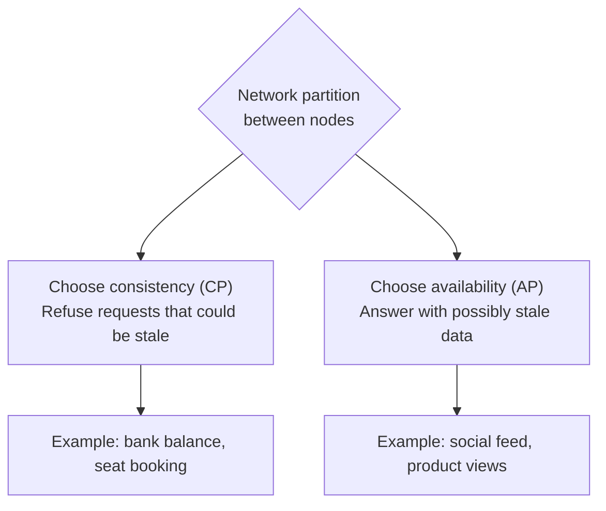

# CAP theorem and consistency

## What it is

The **CAP theorem** says that a distributed data store, during a network **partition**, can guarantee at most two of three properties:

- **C: Consistency.** Every read sees the most recent write (all nodes agree).
- **A: Availability.** Every request gets a non-error response, even if it is stale.
- **P: Partition tolerance.** The system keeps working when messages between nodes are lost or delayed.

Network partitions happen in any real distributed system, so **P is not optional**. The real choice is **C or A** when a partition happens.

| Choice | During a partition | Examples |
|---|---|---|
| **CP** | Some nodes refuse requests. Correct data, but downtime. | HBase, etcd, ZooKeeper, bank ledgers |
| **AP** | All nodes answer. Data may differ until the partition heals. | Cassandra, DynamoDB (default), DNS |

## Consistency models

| Model | Guarantee | Example |
|---|---|---|
| **Strong** | Every read returns the latest write | Inventory count, account balance |
| **Eventual** | All replicas converge if writes stop | Feed, likes count, reviews |
| **Read-your-own-writes** | You always see your own writes | Profile edit followed by a page reload |
| **Monotonic reads** | Once you see a value, you never see an older one | Comment threads |

Eventual consistency is not the same as weak consistency. Eventual consistency guarantees convergence. Weak consistency makes no such guarantee.

## PACELC: the normal-operation trade-off

CAP only describes partitions, which are rare. **PACELC** extends it:

- **P**artition: choose **A**vailability or **C**onsistency.
- **E**lse (no partition): choose **L**atency or **C**onsistency.

Even on a healthy network, strong consistency costs latency, because nodes must coordinate before they answer. This is why a strongly consistent write across regions is slow.

## ACID vs BASE, in one line

- **ACID** (relational databases): transactions are atomic, consistent, isolated, and durable. Pick it when correctness matters more than latency.
- **BASE** (many NoSQL systems): **B**asically **A**vailable, **S**oft state, **E**ventually consistent. Pick it when availability and scale matter more.

Details: [storage](./04-storage.md).

## Choosing per feature

The system does not need one model. Pick per data type:

| Feature | Model | Why |
|---|---|---|
| Product description, reviews | Eventual (AP) | A few seconds of delay is fine |
| Inventory count, order placement | Strong (CP) | Overselling costs money |
| Seat booking | Strong, with a [distributed lock](../building-blocks/distributed-locks.md) | Prevent double-booking |
| Feed, timeline | Eventual (AP) | Stale for a few seconds is acceptable |

## From the books

**CAP as the books define it** (Alex Xu, Ch. 6): consistency means all clients see the same data no matter which node they hit. Availability means every request gets a response, even if some nodes are down. Partition tolerance means the system keeps working despite network breaks. A key-value store is CP (gives up availability during a partition) or AP (gives up consistency during a partition).

**Sloppy quorum** (Alex Xu, Ch. 6): a strict quorum blocks reads and writes when nodes are unreachable. A sloppy quorum uses the first W healthy nodes for writes and the first R for reads, which favors availability.

**Detecting failure** (Alex Xu, Ch. 6; DDIA, Ch. 8): gossip protocols let nodes share membership information without a central coordinator. Timeouts cannot tell a crashed node from a slow network. A node can also be partially failed, for example a NIC that drops to a tiny fraction of its bandwidth.

**Versions and conflicts** (Alex Xu, Ch. 6): *vector clocks* store `[server, version]` pairs per item. They show whether one version descends from another or whether the two are concurrent conflicts. Costs: clients must resolve conflicts, and the clock can grow.

**Consistency strength** (DDIA, Ch. 9):
- **Linearizability:** the system behaves as if there is one copy of the data, and each operation takes effect at one instant. Easy to reason about, but slow over long network paths.
- **Causal consistency:** operations that depend on each other appear in order. Concurrent operations may appear in any order. Cheaper than linearizability.
- **Consensus** (for example, Raft or Paxos) decides one value that all nodes agree on and never revokes. Locks, leader election, unique usernames, and atomic commit all reduce to it.

## Common mistakes

- Saying "I'll use CAP to pick a database" without naming the partition behavior.
- Claiming a system is "CA" in a distributed setting. Partitions cannot be ruled out.
- Choosing strong consistency for everything, which adds latency and reduces availability.
- Forgetting that the choice affects both reads and writes.

## Example decision

The feed is availability-first, so accept eventual consistency and let it lag a few seconds. Payments and inventory are consistency-first, so they go to a strongly consistent store in a single region. During a partition, the payment path refuses writes rather than double-charging.

## Related

- [Replication and fault tolerance](./06-replication-and-fault-tolerance.md)
- [Storage](./04-storage.md)
- [Latency and geography](./01-latency-and-geography.md)

## Sources

- Hello Interview, [Core Concepts: CAP Theorem](https://www.hellointerview.com/learn/system-design/in-a-hurry/core-concepts) (CAP, eventual vs strong, PACELC, per-feature choice)
- Personal notes: "CAP theorem (consistency, availability, partition)" and "CAP Theorem: Should your system prioritize consistency or availability?" ([system-design-interview.md](../system-design-interview.md))
- The CP/AP example database lists are *(general knowledge)*; verify before quoting them.
