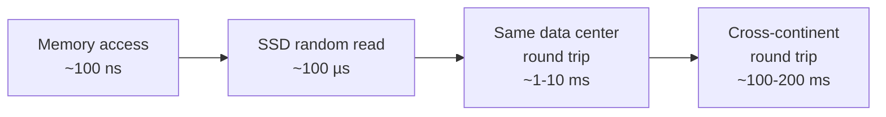

# Numbers to know

## What it is

You do not need to recite numbers from memory. You need rough numbers when you make a decision: "Do we need to shard?", "Can one Redis handle this?", "Do we need a cache?" Use these as orders of magnitude, not exact values.

## Latency

| Operation | Rough latency |
|---|---|
| Memory access | nanoseconds (~100 ns) |
| SSD random read | microseconds (~100 µs) |
| Network call, same data center | 1-10 ms |
| Network call, cross-continent | tens to hundreds of ms |

The gaps between these rows decide whether a cache or a geographic deployment is worth it. See [latency and geography](./01-latency-and-geography.md).

## Component capacity

| Component | Key metrics | Scale triggers (time to consider more) |
|---|---|---|
| **Caching** (Redis, Memcached) | ~1 ms latency; 100k+ ops/s; memory-bound (up to ~1 TB) | Hit rate < 80%; latency > 1 ms; memory > 80%; cache churn |
| **Databases** (Postgres, DynamoDB) | Up to ~50k transactions/s; sub-5 ms cached reads; 64 TiB+ storage | Write throughput > 10k TPS; uncached read latency > 5 ms; need geographic distribution |
| **App servers** | 100k+ concurrent connections; 8-64 cores; 64-512 GB RAM | CPU > 70%; response latency above SLA; connections near 100k per instance; memory > 80% |
| **Message queues** (Kafka) | Up to ~1 million msgs/s per broker; sub-5 ms end-to-end; up to 50 TB | Throughput near 800k msgs/s; ~200k partitions per cluster; growing consumer lag |

Source figures are from Hello Interview and are approximate. Hardware changes over time; use them to estimate, then say so.

## Storage

- A single Postgres instance handles a few terabytes comfortably.
- You do not need [sharding](./05-scalability.md#sharding) until you reach tens or hundreds of terabytes. Proposing it at 500 GB adds complexity for no reason.

## How to use the numbers

1. Estimate the traffic: users x actions per user per day / 86,400 seconds = average requests per second. Use peak = 2-3x average.
2. Estimate the storage: records x size x retention.
3. Compare against the component table above.
4. Decide: a single node, replicas, cache, or sharding.

Example: 50k requests per second, each app server handles about 5k, so about 10 servers plus headroom.

## Common mistakes

- Using outdated numbers (2010-era hardware). Modern machines are much stronger, so you will propose sharding and caching too early.
- Quoting numbers without the decision they support.
- Doing the math only after the design is already chosen, instead of at the decision point.

## Example decision

We expect about 50k requests per second at peak. A well-tuned Postgres handles around 10k writes per second with replicas, so we do not need sharding yet. Reads hit a Redis cache, which handles far more than our read load on one node.

## Related

- [Scalability](./05-scalability.md)
- [Latency and geography](./01-latency-and-geography.md)
- [Distributed cache](../building-blocks/distributed-cache.md)

## Sources

- Hello Interview, [Core Concepts: Numbers to Know](https://www.hellointerview.com/learn/system-design/in-a-hurry/core-concepts) (table and guidance)
- Personal notes: "latency (same region, cross region)" ([system-design-interview.md](../system-design-interview.md))
- Estimation steps (average vs peak, 86,400 seconds per day): *(general knowledge)*
