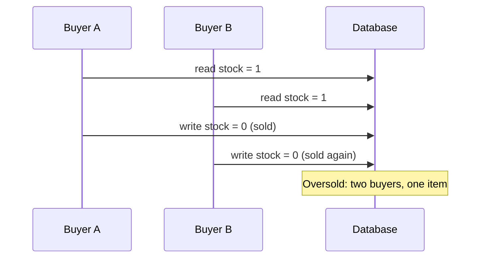
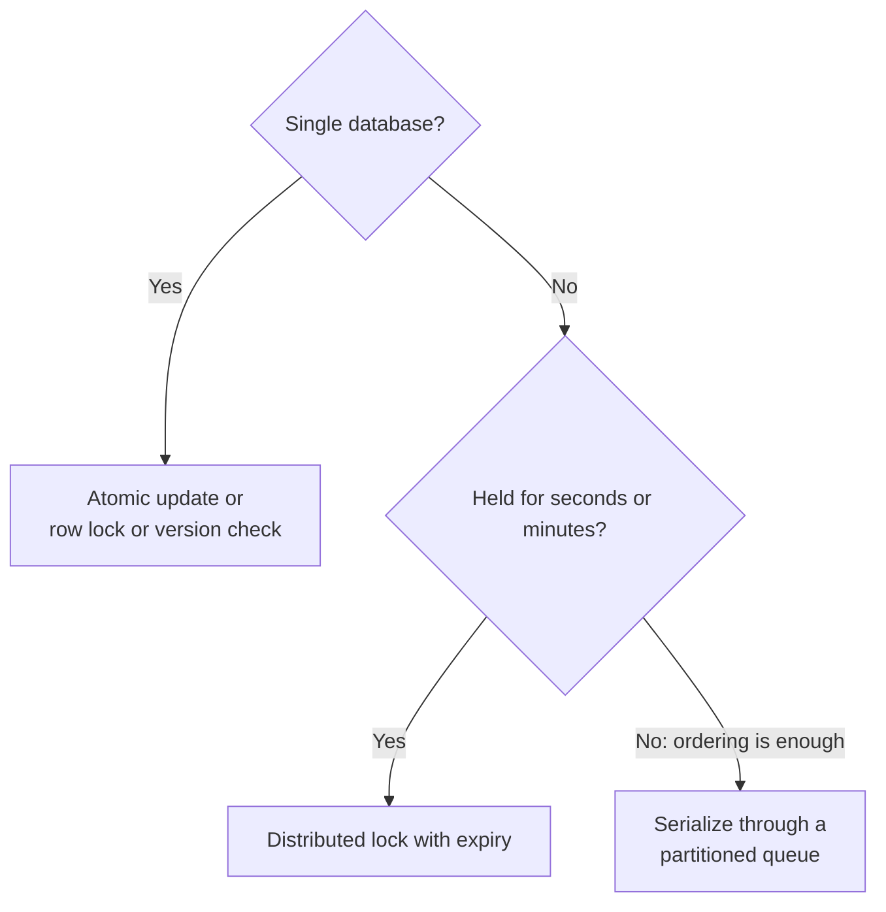

# Pattern: dealing with contention

## Problem

Many users try to change the same resource at once: the last concert ticket, an auction's highest bid, the last item in stock. Without coordination you get race conditions: two buyers both see "1 left" and both buy it.

## Solutions, from simplest

1. **Atomic update in the database:** `UPDATE tickets SET holder = :user WHERE id = :id AND holder IS NULL`. Check rows affected. Simplest and often enough.
2. **Transactions:** group the read and write, with the right isolation level.
3. **Pessimistic locking:** `SELECT ... FOR UPDATE` holds a row lock until commit.
4. **Optimistic concurrency control:** read a version number, write only if it is unchanged; retry on conflict. Good when conflicts are rare.
5. **Distributed locks:** when the resource is held across services or for minutes. See [distributed locks](../building-blocks/distributed-locks.md).
6. **Queue-based serialization:** send all requests for one resource to one queue partition, processed in order.
7. **Two-phase commit:** coordinates a change across several databases. Slow and fragile; avoid unless required.

## Trade-offs

- Locks trade throughput for correctness.
- Optimistic control performs well with few conflicts and retries heavily with many.
- Splitting data across databases gives up what the database already solves. Be careful about splitting prematurely, and state what you give up.

## Common mistakes

- Read-then-write with no lock or condition.
- Distributed locks when a single conditional update would do.
- No expiry on locks.
- Splitting data into several databases before proving the single one is a bottleneck.

## Example decision

Ticket purchase is a conditional update: `UPDATE ... WHERE status = 'available'`, so only one buyer's write affects a row. During checkout, hold the seat with a 10-minute Redis lock so the buyer has time to pay.

## Related

- [Distributed locks](../building-blocks/distributed-locks.md)
- [Consistency per feature](../fundamentals/07-cap-and-consistency.md)
- [Databases](../building-blocks/databases.md)

## Sources

- Hello Interview, [Common Patterns: Dealing with Contention](https://www.hellointerview.com/learn/system-design/in-a-hurry/patterns)
- Ordered list of solutions, `SELECT FOR UPDATE`, optimistic control, and 2PC: *(general knowledge)*
