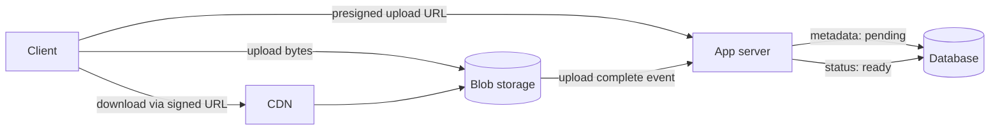

# Pattern: handling large blobs

## Problem

Files such as videos, images, and documents are large. If they travel through your application servers, those servers become bottlenecks: they spend bandwidth and memory on bytes they do not need to process.

## Solution

Clients transfer bytes directly to and from blob storage. Your servers only issue **scoped, temporary credentials** and track metadata.

- **Upload:** presigned URL with expiry, scoped to one object. Multipart upload gives resumable, parallel chunks.
- **Download:** a CDN with signed URLs for access control. The CDN fetches from blob storage on a miss. See [blob storage](../building-blocks/blob-storage.md) and [CDN](../building-blocks/cdn.md).

## Key challenges

- **State sync:** metadata in the database and bytes in storage can disagree. Use `pending` and `ready` states and storage event notifications.
- **Upload failures:** the client may die mid-upload. Use multipart upload to resume, and clean up abandoned uploads with a lifecycle rule.
- **Lifecycle:** deletion, versioning, and retention for large files.

## Trade-offs

- Two systems to keep consistent.
- Presigned URLs are bearer tokens: anyone holding one can use it until expiry. Keep expiry short.

## Common mistakes

- Uploading through the app server "because it is simpler."
- Presigned URLs with no expiry or overly broad permissions.
- Assuming the upload succeeded without waiting for the completion event.

## Example decision

The client requests a presigned URL and uploads the video straight to S3 in multipart chunks. The metadata row stays `pending` until S3's event flips it to `ready`. Viewers stream through CloudFront with signed URLs.

## Related

- [Blob storage](../building-blocks/blob-storage.md)
- [CDN](../building-blocks/cdn.md)
- [Long-running tasks](./long-running-tasks.md) (transcode after upload)

## Sources

- Hello Interview, [Common Patterns: Handling Large Blobs](https://www.hellointerview.com/learn/system-design/in-a-hurry/patterns)
- Hello Interview, [Key Technologies: Blob Storage](https://www.hellointerview.com/learn/system-design/in-a-hurry/key-technologies) (upload and download flow)
- Bearer-token risk and lifecycle rules: *(general knowledge)*
