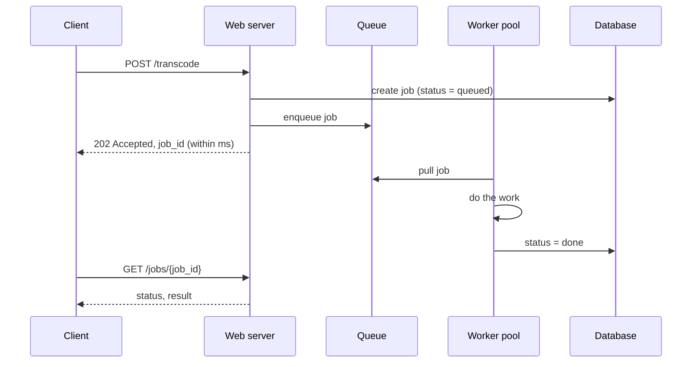

# Pattern: managing long-running tasks

## Problem

Some work takes too long for a request: video encoding, report generation, bulk imports. Holding the connection open ties up servers and times out.

## Solution

Split the operation into two parts:

1. The web server validates the request, enqueues a job, and returns a **job ID** within milliseconds.
2. Worker processes pull jobs and do the work. Web servers and workers scale independently, and a worker crash does not affect the API.

## Required pieces

- **Job status tracking:** a job record with states (queued, running, done, failed) and a way to poll or get notified. See [realtime updates](./realtime-updates.md).
- **Retries:** with backoff, and idempotent workers.
- **Dead letter queue:** for poison messages that always fail. See [queues](../building-blocks/queues.md).
- **Worker pools:** sized by queue depth or CPU.

## When NOT to use it

The source is direct: many designs reach for a queue too quickly. If jobs are short, return the result synchronously. You get simpler architecture, clearer back-pressure, and a better user experience.

## Trade-offs

- Clients must handle a two-step flow.
- More moving parts: queue, workers, status store, DLQ.
- Failure handling is harder; a job can succeed while its status update fails.

## Common mistakes

- Using a queue for a 200 ms operation.
- No job status, so the client cannot know the result.
- Retrying non-idempotent work, so side effects run twice.

## Example decision

Transcoding takes over a minute, so the upload endpoint enqueues a job and returns 202 with a job ID. Workers pull from a queue, retry three times with backoff, and send failures to a DLQ. The client polls the job status, or gets a push update over the realtime channel.

## Related

- [Queues](../building-blocks/queues.md)
- [Multi-step processes](./multi-step-processes.md)
- [Large blobs](./large-blobs.md) (video upload then transcode)

## Sources

- Hello Interview, [Common Patterns: Managing Long-Running Tasks](https://www.hellointerview.com/learn/system-design/in-a-hurry/patterns)
- HTTP 202 Accepted usage and sequence diagram: *(general knowledge)*
