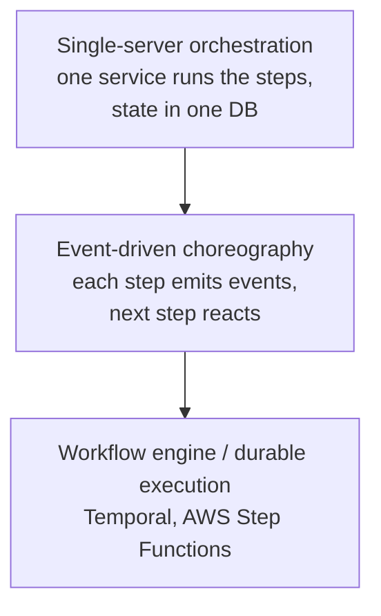

# Pattern: multi-step processes

## Problem

A business process spans several services and steps, and must survive crashes, retries, and slow external calls. Examples: order fulfillment (charge, reserve stock, ship, notify), user onboarding, payment processing.

Without structure, state lives in scattered places, and error handling is ad hoc. A crash between "charged" and "stock reserved" leaves the system inconsistent.

## Solutions, from simplest

- **Single-server orchestration:** one service calls each step and records progress in its database. Simple, and enough for many cases.
- **Event sourcing and choreography:** each step publishes an event (see [streams](../building-blocks/streams.md)) and the next step subscribes. No central coordinator, but the flow is harder to see.
- **Workflow engines:** Temporal or AWS Step Functions store the workflow state, retry steps, and recover after crashes. You write the steps declaratively.

## The key idea

Move from scattered state and manual error handling to a **declarative workflow definition**. The engine guarantees each step runs to completion, retries on failure, and keeps an audit trail. Compensation steps (undo actions) handle failures that cannot be retried, such as refunding a charge if shipping fails (general knowledge).

## Trade-offs

| Approach | Pros | Cons |
|---|---|---|
| Single-server orchestration | Simple, easy to debug | The orchestrator is a bottleneck and a single point of failure |
| Choreography | Decoupled, scales | Hard to see the whole flow; hard to debug |
| Workflow engine | Durable, retries, audit | Another system to run or pay for |

Start simple. Add a workflow engine when the process is long, has many failure paths, or must survive restarts.

## Common mistakes

- Chaining services with synchronous calls and no recovery plan.
- No compensation for steps that already took effect.
- Claiming "exactly-once" without saying how (usually: at-least-once delivery plus idempotent steps).

## Example decision

Checkout is a workflow: charge, reserve stock, create shipment, notify. Run it in Temporal so each step retries on failure and the workflow resumes after a crash. If shipping fails after the charge, a compensation step refunds the payment.

## Related

- [Long-running tasks](./long-running-tasks.md)
- [Queues](../building-blocks/queues.md)
- [Replication and fault tolerance](../fundamentals/06-replication-and-fault-tolerance.md)

## Sources

- Hello Interview, [Common Patterns: Multi-Step Processes](https://www.hellointerview.com/learn/system-design/in-a-hurry/patterns)
- Compensation, at-least-once with idempotent steps, and the three-level comparison table: *(general knowledge)*
