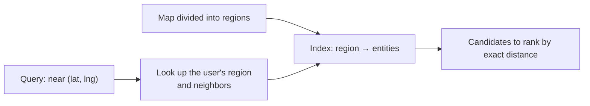

# Pattern: proximity-based services

## Problem

Find entities near a location: drivers near a rider (Uber), stores near a user (Gopuff), restaurants nearby. Scanning every entity by distance does not scale to millions of items.

## Solution: geospatial indexes

A geospatial index groups entities by location so a query only examines nearby cells.

The area is split into manageable regions (for example, geohash or H3 cells). Each entity is indexed under its region. A query checks its region and neighbors and skips everything else.

## Options

- **PostgreSQL with PostGIS:** a relational database extension for geospatial queries.
- **Redis geospatial type:** commands such as nearby-search on sorted sets.
- **Elasticsearch:** geo queries alongside full-text search.
- **Dedicated services:** when the scale or query types go beyond the above.

## When you need it

- A purpose-built index is worth it at hundreds of thousands or millions of items.
- For 1,000 items, scanning all of them is simpler and fast enough. Do not add an index for that.
- Most queries are local. Users look for entities near them, not globally.

## Trade-offs

- Moving entities (drivers) update their location often. Write load on the index can be high. Batch or throttle location updates.
- Edge cases at region boundaries: check neighbors.

## Common mistakes

- Proposing a geospatial index for a small list.
- Forgetting that location data changes constantly and needs a high-write design.
- Ignoring region boundaries.

## Example decision

Drivers publish their location every few seconds. Store them in Redis geo sets, so a nearby query for a rider returns candidates within a few kilometers. Rank candidates by ETA and hold the chosen driver with a short lock so they cannot take two rides.

## Related

- [Latency and geography](../fundamentals/01-latency-and-geography.md)
- [Distributed locks](../building-blocks/distributed-locks.md)
- [Search databases](../building-blocks/search-databases.md)

## Sources

- Hello Interview, [Common Patterns: Proximity-Based Services](https://www.hellointerview.com/learn/system-design/in-a-hurry/patterns)
- Geohash/H3 cells, write-throttling advice, and the "1,000 items" rule of thumb (from the source): *(general knowledge where noted)*
