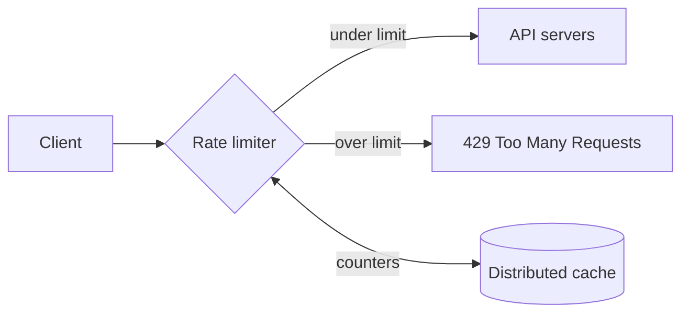
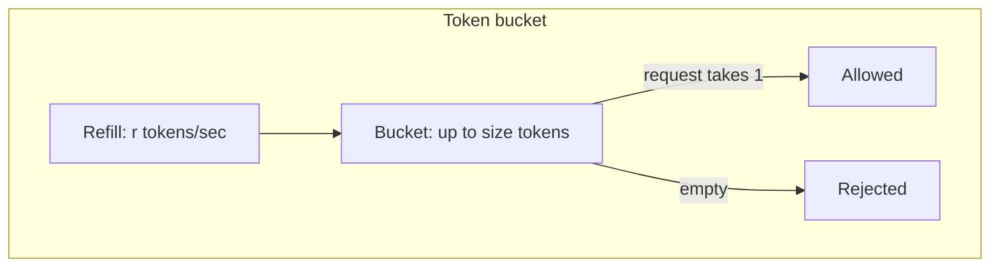

# Pattern: rate limiting

## Problem

Limit how many requests a client or service can send in a time window. Examples: 2 posts per second per user, 10 account creations per day per IP, 300 read requests per user per minute.

Reasons to limit:
- Prevent denial-of-service, whether intentional or accidental.
- Protect servers from bots and misbehaving clients.
- Control cost when a third-party API charges per call.

## Where it sits

It usually lives in the [API gateway](../building-blocks/api-gateway.md) or as middleware in front of the service. Counters live in a shared store such as a [distributed cache](../building-blocks/distributed-cache.md), so every server sees the same count.

## Algorithms

| Algorithm | How it works | Pros | Cons |
|---|---|---|---|
| **Token bucket** | A bucket holds up to `size` tokens, refilled at a fixed rate. Each request takes one token. No token means reject. | Simple, memory-efficient, allows short bursts | Two parameters (size, refill rate) are hard to tune |
| **Leaking bucket** | Requests enter a FIFO queue of fixed size and are processed at a fixed rate. Full queue means reject. | Smooths output to a steady rate | Bursts wait in the queue; old requests can crowd out new ones |
| **Fixed window counter** | Count requests per fixed window (for example, per minute) | Very simple | Spikes at window edges let up to 2x the limit through |
| **Sliding window log** | Store a timestamp for each request and count those in the last N seconds | Accurate | High memory, since it stores every timestamp |
| **Sliding window counter** | Weight the previous window's count by how much of it overlaps the current window | Close to accurate, cheap | An approximation |

## Distributed concerns

- **Race conditions:** two servers read the same counter and both allow the request. Fix with atomic operations (for example, Redis `INCR` or a Lua script) or per-key locks.
- **Synchronization:** many servers each keeping local counters undercount. Use one shared store, or accept approximate limits with sticky routing.
- **Per-rule buckets:** the same user may need separate buckets per endpoint. Limiting by IP needs one bucket per IP. A global limit needs one shared bucket.

## Trade-offs

- Tight limits reject legitimate users. Return a `429` with `Retry-After` and rate-limit headers so clients can back off.
- A shared store adds latency to every request. Keep the check cheap.

## Common mistakes

- Using fixed windows and ignoring the boundary burst.
- Keeping counters per server, so the real limit is multiplied by the number of servers.
- Forgetting to tell clients how long to wait.

## Example decision

Token bucket in the gateway, with one bucket per user per endpoint, stored in Redis. The refill rate sets the sustained limit and the bucket size allows short bursts. Each check is one atomic Lua script, so two gateways cannot both spend the last token. Rejected requests get a 429 with `Retry-After`.

## Related

- [API gateway](../building-blocks/api-gateway.md)
- [Distributed cache](../building-blocks/distributed-cache.md)
- [Contention](./contention.md) (race conditions on shared counters)

## Sources

- Alex Xu, *System Design Interview*, Ch. 4 "Design a Rate Limiter": the algorithm list, token bucket and leaking bucket parameters, and the distributed race-condition and synchronization discussion.
- Hello Interview patterns page for the general idea of rate limiting as a gateway concern.
- The fixed-window boundary burst, the atomic Lua script advice, and the `Retry-After` header: *(general knowledge)*
