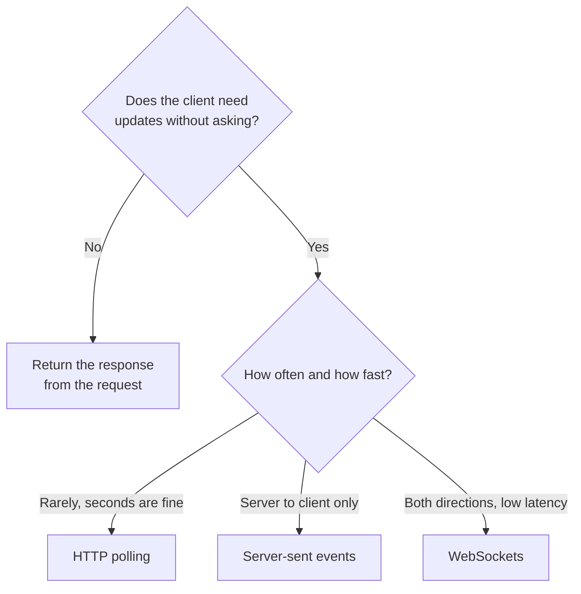

# Pattern: pushing realtime updates

## Problem

The user must see changes as they happen: chat messages, notifications, live dashboards, collaborative editing. A normal request-response call only returns once.

## Options

- **HTTP polling:** simplest. The client asks every few seconds. Wasteful at scale. Start here and move on only when it stops working.
- **Server-sent events (SSE):** a one-way stream from server to client over HTTP.
- **WebSockets:** two-way persistent connection. Needs sticky routing and L4 load balancing. See [load balancers](../building-blocks/load-balancers.md).

## Server-side design

- **Pub/Sub:** decouples the publisher from subscribers. Used in WhatsApp-style chat. See [streams](../building-blocks/streams.md).
- **Stateful servers on a consistent hash ring:** when processing is heavy and each document or session has one owner, as in collaborative editing (Google Docs). See [consistent hashing](../fundamentals/05-scalability.md#consistent-hashing).

## Challenges

- Connections are long-lived: each server holds many open sockets, so memory and file descriptors become the limit.
- Reconnects: clients must recover missed messages (use a sequence number or last-seen ID).
- Fan-out: one update may go to thousands of subscribers.

## Trade-offs

| Option | Pros | Cons |
|---|---|---|
| Polling | Simple, stateless | Latency and wasted requests |
| SSE | Simple one-way push, HTTP-friendly | One direction only |
| WebSockets | Bidirectional, low latency | Stateful infrastructure, harder to scale |

## Common mistakes

- Jumping to WebSockets when polling would do.
- Forgetting reconnection and missed messages.
- Not saying which load balancer layer handles the connections.

## Example decision

Start with polling every 5 seconds for the dashboard. If that load is too high, move to SSE, since updates only flow from server to client. For chat, use WebSockets behind an L4 balancer, with a pub/sub topic per room so any server can deliver messages.

## Related

- [Networking](../fundamentals/02-networking.md)
- [Streams](../building-blocks/streams.md)
- [Load balancers](../building-blocks/load-balancers.md)

## Sources

- Hello Interview, [Common Patterns: Pushing Realtime Updates](https://www.hellointerview.com/learn/system-design/in-a-hurry/patterns)
- Ordering with sequence numbers and the SSE vs WebSocket table: *(general knowledge)*
