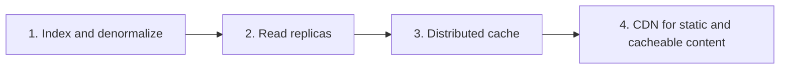

# Pattern: scaling reads

## Problem

Read traffic grows faster than write traffic and usually hits the bottleneck first. Read-to-write ratios are often 10:1 and can reach 100:1. Example: opening Instagram loads dozens of photos, which is hundreds of queries, while the user posts once a day.

## Solution: escalate in this order

1. **Optimize inside the database:** indexes for the queries you actually run, and denormalized columns or precomputed tables to avoid joins. See [storage](../fundamentals/04-storage.md).
2. **Read replicas:** followers serve reads; the leader serves writes. See [replication](../fundamentals/06-replication-and-fault-tolerance.md).
3. **Distributed cache:** keep hot results in Redis or Memcached. See [distributed cache](../building-blocks/distributed-cache.md).
4. **CDN:** for media and public, cacheable responses. See [CDN](../building-blocks/cdn.md).

## Key issues

- **Cache invalidation:** when does a cached value stop being true?
- **Replication lag:** a replica may not show a write yet. Read from the leader for a short window after a user writes.
- **Hot keys:** millions of users request the same popular item. Cache it at the edge or replicate it, and avoid one shard owning it.

## Trade-offs

| Step | Gain | Cost |
|---|---|---|
| Indexes | Fast queries | Slower writes, more storage |
| Denormalization | No joins | Duplicated data to keep in sync |
| Replicas | Read capacity | Replication lag |
| Cache | Lowest latency | Staleness, invalidation logic |

## Common mistakes

- Adding a cache before adding an index.
- Caching without an invalidation plan.
- Sending read-after-write traffic to a lagging replica.

## Example decision

The feed is read-heavy, around 100 to 1. Index posts by author and timestamp, add two read replicas for the feed queries, and cache each user's timeline in Redis with a short TTL. Users see their own new post immediately because their own writes are read from the leader.

## Related

- [Scalability](../fundamentals/05-scalability.md)
- [Distributed cache](../building-blocks/distributed-cache.md)
- [Scaling writes](./scaling-writes.md)

## Sources

- Hello Interview, [Common Patterns: Scaling Reads](https://www.hellointerview.com/learn/system-design/in-a-hurry/patterns)
- Read-your-own-writes mitigation and the escalation order as a diagram: *(general knowledge)*
