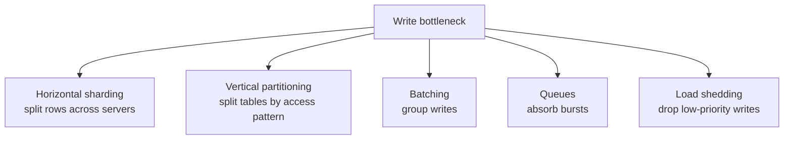

# Pattern: scaling writes

## Problem

Write volume grows until a single database server or storage system hits its limit. Adding read replicas does not help, because every replica must apply every write.

## Strategies

- **Horizontal sharding:** distribute rows across servers by a key. See [scalability](../fundamentals/05-scalability.md#sharding).
- **Vertical partitioning:** move hot, write-heavy columns or tables to their own database, separate from cold data.
- **Batching:** combine many small writes into one, which reduces per-operation overhead.
- **Write queues:** buffer spikes and drain at a steady rate. See [queues](../building-blocks/queues.md).
- **Load shedding:** when overloaded, reject or delay low-priority writes so critical ones get through.

## Choosing the partition key

A good key spreads load evenly **and** keeps related data together.

- Good: `user_id` for a user-centric app. A user's writes hit one shard.
- Bad: `created_date`. All of today's writes hit one shard (hot spot).
- Bad: a key with a few very popular values, like `country` for a global product.

## Trade-offs

- Sharding makes cross-shard transactions and global queries expensive.
- Queues hide overload instead of fixing capacity. Use backpressure.
- Batching adds latency for the first item in each batch.

## Common mistakes

- Sharding before the capacity math says you need it.
- Picking a partition key that creates a hot spot.
- Forgetting that writes in a queue are not yet durable in the database.

## Example decision

Click events are the write-heavy part. Buffer them in Kafka, partitioned by `user_id`, and batch-insert into the analytics store every few seconds. The primary Postgres keeps orders on a separate instance, so bursts of clicks cannot slow checkout.

## Related

- [Scaling reads](./scaling-reads.md)
- [Scalability](../fundamentals/05-scalability.md)
- [Streams](../building-blocks/streams.md)

## Sources

- Hello Interview, [Common Patterns: Scaling Writes](https://www.hellointerview.com/learn/system-design/in-a-hurry/patterns)
- Hot-spot example, load shedding, and batch latency trade-off: *(general knowledge)*
