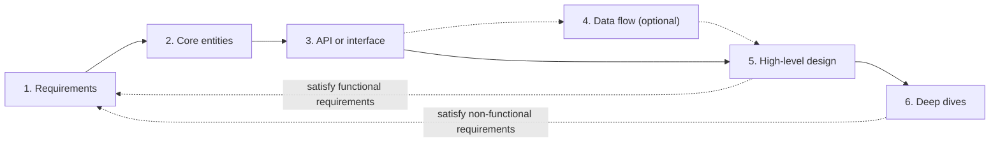
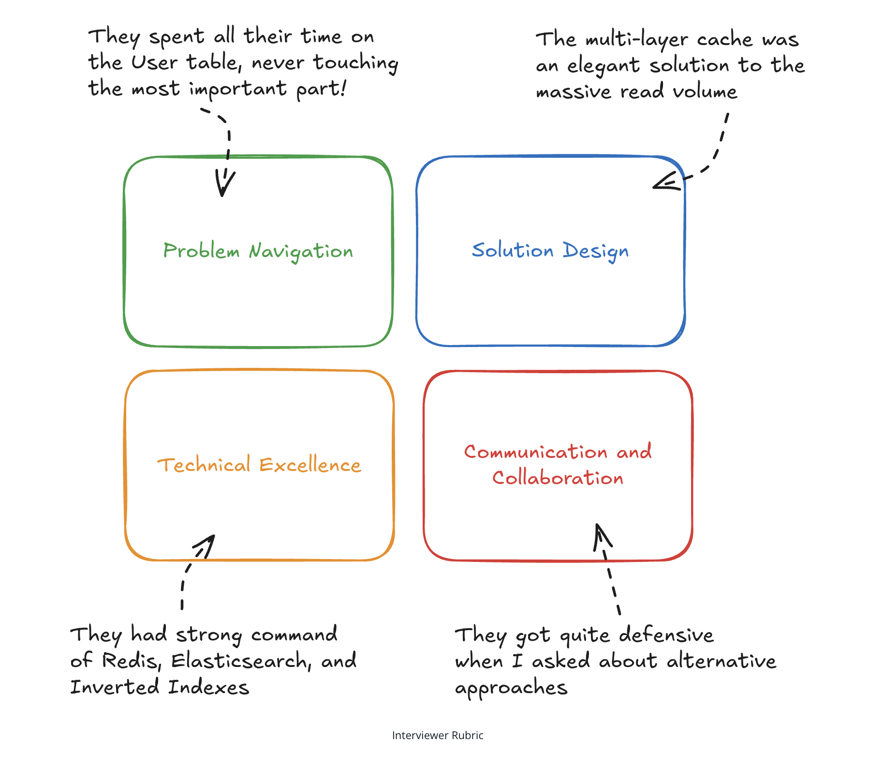
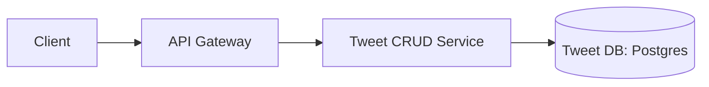
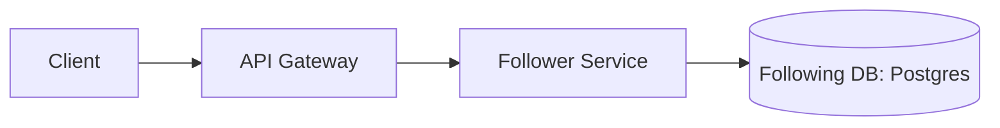
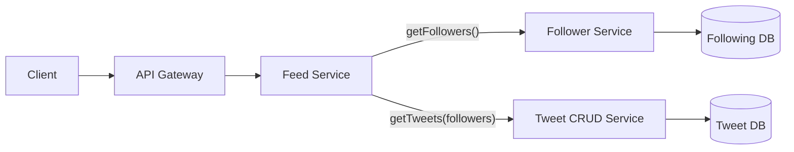
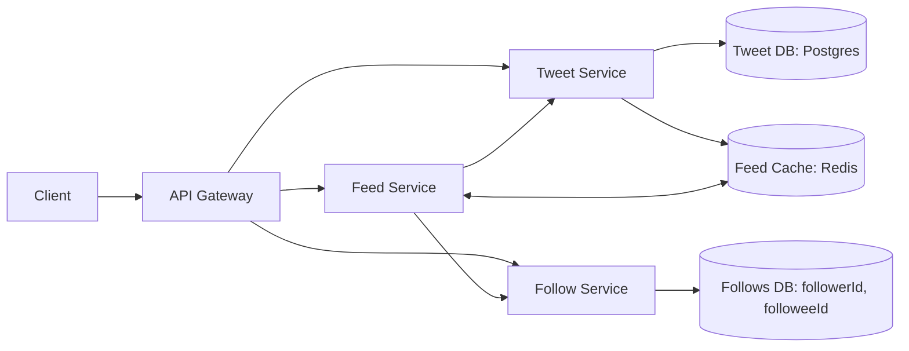
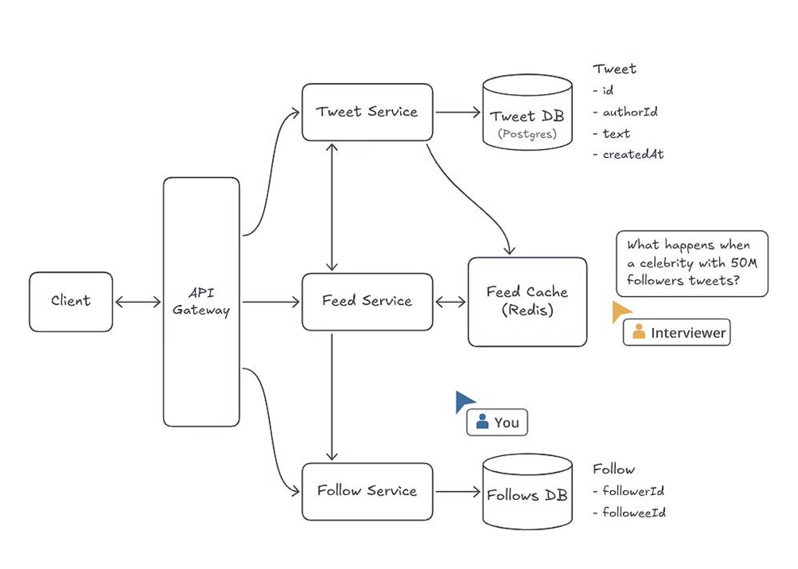

# Delivery Framework

A system design interview is a collaborative, open-ended conversation. The interviewer evaluates how you structure an ambiguous problem, not whether you memorized a specific architecture.

## The six steps



| # | Step | Goal | Output |
|---|---|---|---|
| 1 | **Requirements** | Understand what you are building | 3 to 5 functional requirements and the top 3 to 5 non-functional requirements |
| 2 | **Core entities** | Find the nouns | List such as User, Tweet, Follow |
| 3 | **API or interface** | Define the contract with clients | Endpoints mapped to the functional requirements |
| 4 | **Data flow** (optional) | Describe the process step by step | Sequence of actions from input to output |
| 5 | **High-level design** | Draw the components | Boxes (services, DBs, caches) and arrows, built one endpoint at a time |
| 6 | **Deep dives** | Harden the design | Solutions for scale, latency, failures, edge cases |

Do not spend time on exact numbers at the beginning. Do the capacity math when a decision depends on it.

## 1. Requirements

**Functional:** "Users should be able to..." Core features.

**Non-functional:** "The system should be..." Quality attributes. Pick the 3 to 5 that matter most. Consider:

| Requirement | Question to ask |
|---|---|
| CAP trade-off | Consistency or availability when a partition happens? (partition tolerance is a given) |
| Environment | Mobile device, low battery, limited bandwidth (for example, video on 3G)? |
| Scalability | Bursty traffic? Holidays? Read-to-write ratio? |
| Latency | How fast must a response be? Which requests do heavy computation? |
| Durability | Can data be lost? (a social feed can tolerate more loss than a bank) |
| Security | Data protection, access control, compliance |
| Fault tolerance | Redundancy, failover, recovery |
| Compliance | Legal or regulatory constraints |

## 2. Core entities

- Who are the actors? Do they overlap?
- Which nouns are needed to satisfy the functional requirements?

## 3. API

Choose the protocol:

| Protocol | Use when |
|---|---|
| **REST** | Default for most interviews. Maps resources to HTTP verbs. |
| **GraphQL** | Diverse clients with different data needs; avoids over- and under-fetching. |
| **RPC (gRPC)** | Internal service-to-service calls where performance matters. |

Then list the endpoints. For product-style interviews, they usually map one-to-one with the functional requirements. See [03-api-design.md](../fundamentals/03-api-design.md).

## 4. Data flow (optional)

A high-level sequence of what happens to an input to produce an output. Useful for pipelines such as "upload video, transcode, notify user."

## 5. High-level design

- Draw boxes and arrows: servers, databases, caches, queues.
- Go **one endpoint at a time**. Start from the client and add components as each endpoint needs them.
- Put a load balancer or API gateway at the front. You do not need one in front of every service.

## 6. Deep dives

- Check that the design meets each non-functional requirement.
- Handle edge cases.
- Find bottlenecks and single points of failure.

Good deep dives come from the non-functional requirements. For example, "scale to 100M DAU" leads to horizontal scaling, caches, and sharding.

## Rubric: what interviewers grade



| Area | Strong signal | Weak signal (from the rubric example) |
|---|---|---|
| **Problem navigation** | Spends time on the hardest part of the problem | Spent all the time on the User table and never touched the most important part |
| **Solution design** | Elegant solutions to the real bottleneck | A multi-layer cache was an elegant answer to the massive read volume |
| **Technical excellence** | Command of tools and their internals | Strong command of Redis, Elasticsearch, and inverted indexes |
| **Communication and collaboration** | Welcomes alternatives and trade-offs | Got defensive when asked about alternative approaches |

Key takeaway: know the tools, but spend your time on the hard part of the problem and stay open to other approaches.

## Worked example: Twitter

### 1. Requirements

- **Functional:** post tweets, follow users, see tweets from people you follow.
- **Non-functional:** highly available (prefer availability over consistency); scale to 100M+ DAU; feeds render in under 200 ms.

### 2. Core entities

`User`, `Tweet`, `Follow`

### 3. API

```
POST /v1/tweets           body: { text }
GET  /v1/tweets/{tweetId} -> Tweet
POST /v1/follows          body: { followee_id }
GET  /v1/feed             -> Tweet[]
```

### 4. High-level design, one endpoint at a time

**Endpoint 1: POST /v1/tweets**



Tweet fields: `id`, `authorId`, `text`, `media: s3Links[]`.

**Endpoint 2: GET /v1/tweets/{tweetId}**


**Endpoint 3: POST /v1/follows**



Follow fields: `userId1`, `userId2` (follower and followee).

**Endpoint 4: GET /v1/feed**



### 5. Full design after the first pass



The second pass adds a **Feed Cache (Redis)** because the feed endpoint is read-heavy and must be fast.

### 6. Deep dives

1. **Scale to 100M+ DAU:** horizontal scaling of stateless services, read caching, and sharding the tweet and follow stores (see [05-scalability.md](../fundamentals/05-scalability.md)).
2. **Feed latency under 200 ms:** the central trade-off is *fanout-on-read* vs *fanout-on-write* *(general knowledge)*:
   - **Fanout-on-read:** build the feed when the user asks. Cheap writes, slow reads for users who follow many accounts.
   - **Fanout-on-write:** when someone tweets, push the tweet into each follower's cached feed. Fast reads, expensive writes for accounts with many followers.
   - **Hybrid:** fanout-on-write for normal accounts, fanout-on-read for celebrities.

The interviewer's question "what happens when a celebrity with 50M followers tweets?" points exactly at the hybrid approach. The fanout-on-write cost is 50M cache updates for a single tweet.



## Common mistakes

- Spending most of the time on one table or one service.
- Drawing a load balancer in front of every component.
- Proposing sharding or microservices before the numbers justify them.
- Saying "I'll use a cache" without naming the data structure and the invalidation strategy.
- Rejecting alternatives instead of comparing them.

## Related

- [Common patterns](../patterns/)
- [Numbers to know](../fundamentals/08-numbers-to-know.md)
- [Original summary](../system-design-interview.md)
