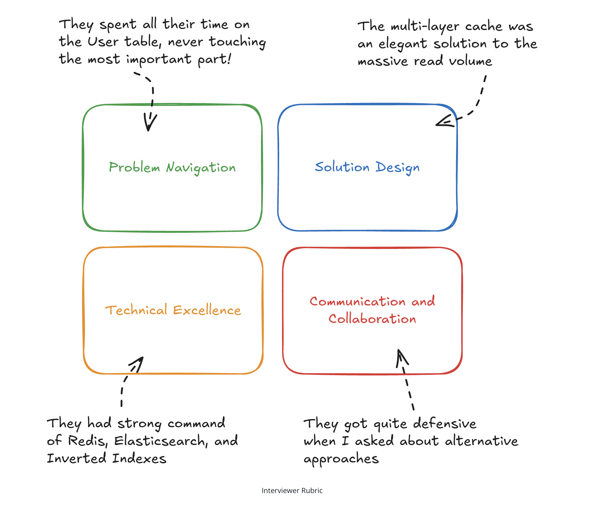
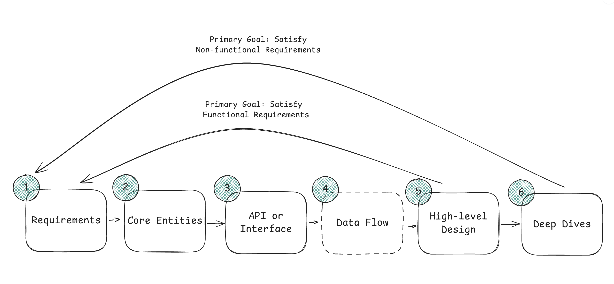
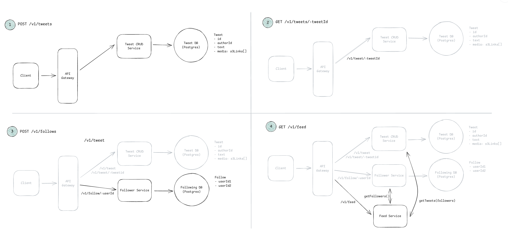
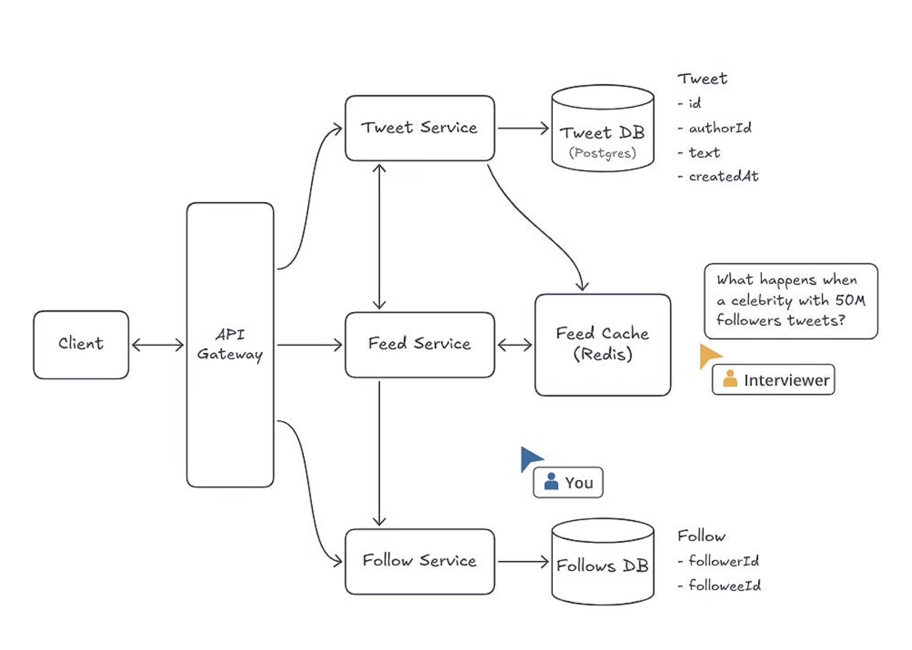

# System Design Interview
A system design interview is a collaborative, open-ended technical interview where a software engineer is asked to architect a large-scale, real-world software system.

Unlike a coding interview—which tests specific algorithms and data structures by writing code—a system design interview evaluates your technical breadth, communication, structured thinking, and decision-making when dealing with ambiguity



## Rubric: what interviewers grade

| Area | Strong signal | Weak signal (from the rubric example) |
|---|---|---|
| **Problem navigation** | Spends time on the hardest part of the problem | Spent all the time on the User table and never touched the most important part |
| **Solution design** | Elegant solutions to the real bottleneck | A multi-layer cache was an elegant answer to the massive read volume |
| **Technical excellence** | Command of tools and their internals | Strong command of Redis, Elasticsearch, and inverted indexes |
| **Communication and collaboration** | Welcomes alternatives and trade-offs | Got defensive when asked about alternative approaches |

Key takeaway: know the tools, but spend your time on the hard part of the problem and stay open to other approaches.

## Delivery Framework



1. Requirements: Get a clear understanding of the system that you are being asked to design.
    - Functional requirements:  "Users/Clients should be able to..." statements. Core features of your system.
    - Non functional requirements: The system should be able to..." or "The system should be..." statements. Statements about the system qualities 
        
    ```
    NOTE: You'll want to identify the top 3-5 that are most relevant to your system.

    - CAP Theorem: Should your system prioritize consistency or availability? Note, partition tolerance is a given in distributed systems.

    - Environment Constraints: Are there any constraints on the environment in which your system will run? For example, are you running on a mobile device with limited battery life? Running on devices with limited memory or limited bandwidth (e.g. streaming video on 3G)?

    - Scalability: All systems need to scale, but does this system have unique scaling requirements? For example, does it have bursty traffic at a specific time of day? Are there events, like holidays, that will cause a significant increase in traffic? Also consider the read vs write ratio here. Does your system need to scale reads or writes more?

    - Latency: How quickly does the system need to respond to user requests? Specifically consider any requests that require meaningful computation. For example, low latency search when designing Yelp.

    - Durability: How important is it that the data in your system is not lost? For example, a social network might be able to tolerate some data loss, but a banking system cannot.

    - Security: How secure does the system need to be? Consider data protection, access control, and compliance with regulations.

    - Fault Tolerance: How well does the system need to handle failures? Consider redundancy, failover, and recovery mechanisms.

    - Compliance: Are there legal or regulatory requirements the system needs to meet? Consider industry standards, data protection laws, and other regulations.
    ```

2. Core entities: What data you need to store to support the requirements.
    - Who are the actors in the system? Are they overlapping?
    - What are the nouns or resources necessary to satisfy the functional requirements?

3. API: Define the contract between your system and its users. Oftentimes, especially for full product style interviews, this maps directly to the functional requirements you've already identified.

    - Which **protocol** do you use: 
    
    ```
    - REST (Representational State Transfer): Uses HTTP verbs (GET, POST, PUT, DELETE) to perform CRUD operations on resources. This should be your default choice for most interviews.

    - GraphQL: Allows clients to specify exactly what data they want to receive, avoiding over-fetching and under-fetching. Choose this when you have diverse clients with different data needs.

    - RPC (Remote Procedure Call): Action-oriented protocol (like gRPC) that's faster than REST for service-to-service communication. Use for internal APIs when performance is critical.
    ````

    - Wich **endpoints** do you need?

4. Data Flow (optional): High level sequence of actions or processes that the system performs on the inputs to produce the desired outputs.

5. High level design: This consists of drawing boxes and arrows to represent the different components of your system and how they interact. Components are basic building blocks like servers, databases, caches, etc.

> [!NOTE]
> In most cases, you can even go one-by-one through your API endpoints and build up your design sequentially to satisfy each one

6. Deep Dive: Harden your design by
- Ensuring it meets all of your non-functional requirements
- Addressing edge cases
- Identifying and addressing issues and bottlenecks

## Example: Build Twitter

### 1. Requirements

Functional:
- Users should be able to post tweets
- Users should be able to follow other users
- Users should be able to see tweets from users they follow

Non functional:
- The system should be highly available, prioritizing availability over consistency
- The system should be able to scale to support 100M+ DAU (Daily Active Users)
- The system should be low latency, rendering feeds in under 200ms

### 2. Core entities
- User
- Tweet
- Follow

### 3. API
```
POST /v1/tweets
body: {
  "text": string
}

GET /v1/tweets/{tweetId} -> Tweet

POST /v1/follows
body: {
  "followee_id": string
}

GET /v1/feed -> Tweet[]
```

### 4. High level design: one endpoint at a time


### 5. Deep dive: One of our non-functional requirements for Twitter was that our system needs to scale to >100M DAU. We could then lead a discussion oriented around horizontal scaling, the introduction of caches, and database sharding.

Another was that feeds need to be fetched with low latency. In the case of Twitter, this is actually the most interesting problem. We'd lead a discussion about fanout-on-read vs fanout-on-write and the use of caches:

- **Fanout-on-read:** build the feed when the user asks. Cheap writes, slow reads for users who follow many accounts.
- **Fanout-on-write:** when someone tweets, push the tweet into each follower's cached feed. Fast reads, expensive writes for accounts with many followers.
- **Hybrid:** fanout-on-write for normal accounts, fanout-on-read for celebrities. "What happens when a celebrity with 50M followers tweets?" points to this: fanout-on-write would mean 50M cache updates for one tweet.



## Common mistakes

- Spending most of the time on one table or one service.
- Drawing a load balancer in front of every component.
- Proposing sharding or microservices before the numbers justify them.
- Saying "I'll use a cache" without naming the data structure and the invalidation strategy.
- Rejecting alternatives instead of comparing them.

## Resources

- [Delivery Framework by Hello Interview](https://youtu.be/FkLAEAcQXcc?si=THyc3V07zL8142R6)
- [System design interview by Alex Xu](./resources/System%20Design%20Interview%20by%20Alex%20Xu.pdf)
- [Designing Data Intensive Applications by Martin Kleppmann.pdf](./resources/Designing%20Data%20Intensive%20Applications%20by%20Martin%20Kleppmann.pdf)